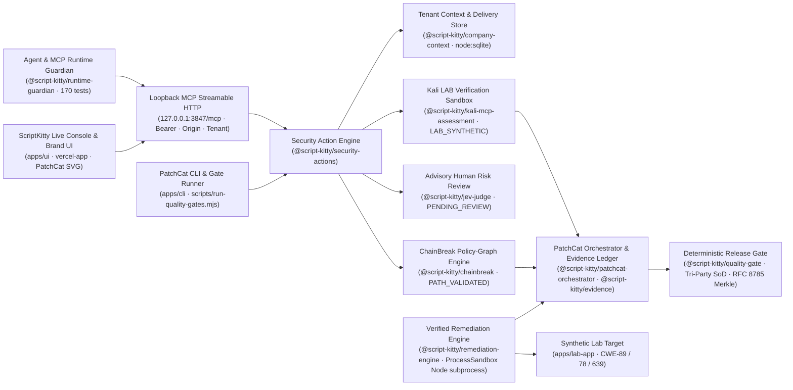

<p align="center">
  
</p>

<h1 align="center">ScriptKitty Live</h1>

<p align="center">
  <strong>Security that sees the whole attack path — Deterministic Policy-Graph Verification (ChainBreak), Verified Remediation &amp; Agent / MCP Runtime Defense, powered by PatchCat.</strong>
</p>

<p align="center">
  <a href="LICENSE"></a>
  <a href="docs/SECURITY_BOUNDARIES.md"></a>
  <a href="docs/IMPLEMENTATION_PLAN.md"></a>
  <a href="docs/CLAIMS_MATRIX.md"></a>
  <a href="PROVENANCE.md"></a>
</p>

> [!IMPORTANT]
> **Hack Brasil 2026 Submission Status & Strict LAB Boundary**  
> - **Competition Repository:** [`https://github.com/andrecodexvictor/scriptkitty-live-hackbrasil-2026`](https://github.com/andrecodexvictor/scriptkitty-live-hackbrasil-2026) *(Staging & provenance split documented in [`PROVENANCE.md`](PROVENANCE.md); final push gated on `HUMAN_APPROVAL_REQUIRED`)*.  
> - **Public Web Preview:** **`[Pending Public Deploy — HUMAN_APPROVAL_REQUIRED]`** *(Run locally in one command via `npm run demo:live` on `http://127.0.0.1:5173`)*.  
> - **Non-Production Safety Lock:** **ScriptKitty Live** operates strictly in isolated **`LAB`** mode (`productionTested: false`, `mergeAllowed: false`, `deployAllowed: false`, `autoApplyAllowed: false`, `externalExecution: false`). External cloud/API integrations default fail-closed to **`NOT_CONFIGURED`** unless explicit operator credentials are supplied.

---

## 1. The Problem

Modern engineering teams face two compounding security blind spots:
1. **Alert Fatigue from Probabilistic Scanners:** LLM-only security scanners flood teams with unverified findings and speculative patches that break legitimate workflows or hallucinate severity without deterministic proof.
2. **Invisible Multi-Hop Risk Across Agents & MCP Tools:** A single permission change on an autonomous agent or Model Context Protocol (MCP) tool can quietly connect an external identity to restricted customer payment/PII data and an unauthorized external destination — while traditional static scanners examine files in isolation and miss the end-to-end attack path.

---

## 2. The Solution: ScriptKitty Live & PatchCat

**ScriptKitty Live** pairs **PatchCat** (our observant autonomous security operator) with four deterministic, fail-closed capabilities:

- **ChainBreak (Primary Capability — Policy-Graph & Attack-Path Reachability):** Models identities, agents, MCP tools, APIs, services, data assets, and external destinations. ChainBreak proves multi-hop attack paths deterministically (`PATH_VALIDATED`, never overclaiming live production exploitation `EXPLOIT_CONFIRMED`), citing exact policy `sourceRef` lines and SHA-256 input digests (`inputSha256`).
- **Verified Remediation:** Synthesizes minimal counterfactual permission diffs (`REMOVE_EDGE`) that eliminate unauthorized attack paths (`1 -> 0`) while mathematically proving all legitimate business workflows remain intact (`3/3`), alongside AppSec code reproduction and patching (`CWE-89` SQLi, `CWE-78` CMDi, `CWE-639` IDOR) inside an env-scrubbed offline Node subprocess sandbox (`ProcessSandbox`: `NO_PROXY=*`, `shell: false`, `1 MiB` output cap — rather than OS/container isolation) with automatic rollback on regression.
- **Continuous Security Audit & Tri-Party Release Gate:** Seals every finding, reproducer receipt, diff, and gate verdict in an RFC 8785 SHA-256 binary Merkle ledger bound to the Git commit SHA, enforcing Tri-Party Separation of Duties ($A_{\text{disc}} \ne A_{\text{veri}} \ne A_{\text{auth}}$) so no agent can self-certify (`E_SOD_SELF_CERTIFICATION` -> `REJECT`).
- **Agent & MCP Security:** Exposes security actions over loopback MCP Streamable HTTP (`127.0.0.1:3847/mcp`) with Bearer auth (`401`), strict `Origin` allowlisting (`403`), and server-derived tenant isolation (`FORBIDDEN`), protected at runtime by **Runtime Guardian** (tool-poisoning SHA-256 manifest pinning, prompt-injection & secret-egress guards, HMAC-SHA256 delegation) and a hardened **Kali Linux LAB Verification Sandbox** (`LAB_SYNTHETIC` scope manifest, static `--` argv, zero raw shell).

---

## 3. ChainBreak Before / After Proof (`payments-lab` Rollout Scenario)

| Scenario Fixture | Policy Graph State | Forbidden Attack Paths | Legitimate Business Workflows | Finding Status | Key Proof & Receipt (`evidence/`) |
|---|---|---|---|---|---|
| **`payments-lab/baseline`** | Compliant baseline: support agent reads profile; finance service processes payments in isolated scope | **`0`** | **`3 / 3` Preserved** (`true`) | Clean (`0` violations) | `inputSha256: 76c07c43...` · `evidence/chainbreak-baseline.json` |
| **`payments-lab/unsafe-rollout`** | Candidate rollout grants `mcp_tool:report-exporter` `can_read` on `data_asset:customer-payment-pii` | **`1`** (`P1` breach chain to `external-report-sink`) | **`3 / 3` Preserved** (`true`) | **`PATH_VALIDATED`** *(never `EXPLOIT_CONFIRMED`)* | Violates `NO_RESTRICTED_DATA_EXTERNAL_TRANSFER` via `e-rollout-exporter-read-pii` (`report-exporter-rollout.yaml#L24`) · `evidence/chainbreak-unsafe.json` |
| **`payments-lab/remediated`** | Minimal counterfactual fix (`REMOVE_EDGE` on `e-rollout-exporter-read-pii`, `requiresHumanApproval: true`) | **`0`** (`1 -> 0` delta) | **`3 / 3` Preserved** (`true`) | Remediated (`0` violations) | Preserves `op-finance-process-payments`, `op-non-sensitive-export`, `op-support-read-profile` · `evidence/chainbreak-remediated.json` |
| **`payments-lab/negative-control`** | Mismatched edge types, incompatible tenant scope, and unsatisfied conditions | **`0`** | **`3 / 3` Preserved** (`true`) | **`0` False Positives** | Proves arbitrary call sequences do not trigger false leaks |

---

## 4. 90-Second Judge Walkthrough

Run the full interactive stack locally on loopback (`127.0.0.1`) in two commands (Windows PowerShell 5.1 compatible):

```powershell
npm install; if ($LASTEXITCODE -ne 0) { exit $LASTEXITCODE }
npm run build; if ($LASTEXITCODE -ne 0) { exit $LASTEXITCODE }
npm run demo:live
```

1. **0:00–0:20 · Connect Live over Loopback MCP HTTP:** Open `http://127.0.0.1:5173`. The **ScriptKitty Live** console connects to the local MCP Streamable HTTP server at `http://127.0.0.1:3847/mcp` (`MODE: LIVE MCP HTTP`). On **`payments-lab/baseline`**, **PatchCat** stays in calm `verified` posture: `0` forbidden paths and `3/3` legitimate operations intact.
2. **0:20–0:45 · Inspect the Attack Path with ChainBreak:** Click the **`unsafe-rollout`** tab (`#tab-unsafe-rollout`). **ChainBreak** highlights the 3-hop breach chain (`identity:support-agent -> mcp_tool:report-exporter -> data_asset:customer-payment-pii -> destination:external-report-sink`) as `PATH_VALIDATED` (`P1`), citing exact policy `sourceRef` lines and SHA-256 evidence receipts. Advisory risk review escalates to `PENDING_REVIEW` for mandatory human judgment (`p0DefinedByJevAlone: false`).
3. **0:45–1:10 · Apply Counterfactual Verified Remediation:** Click **Preview Fix Diff** (`#btn-pr-suggest`). PatchCat proposes removing only `e-rollout-exporter-read-pii` (`REMOVE_EDGE`), switching to **`payments-lab/remediated`** and proving forbidden paths drop from **`1 -> 0`** while **`3/3`** legitimate workflows remain green.
4. **1:10–1:30 · Verify Tri-Party Separation of Duties & Merkle Custody:** In the **Release Gate & Custody Proof** panel, toggle **Simulate Agent Self-Certification** (`#btn-toggle-self-cert`) to watch the gate immediately **`REJECT`** (`E_SOD_SELF_CERTIFICATION`). Restore independent 3-party review (`A_disc != A_veri != A_auth`) to obtain a cryptographic **`PASS`** with a 64-hex RFC 8785 Merkle root while `mergeAllowed: false` and `deployAllowed: false` remain enforced.

For the 10-stage terminal walkthrough (`node scripts/demo-wednesday.mjs`) and cold-start checks, see [`evidence/DEMO_RUNBOOK.md`](evidence/DEMO_RUNBOOK.md).

---

## 5. Quickstart & Verification Commands (Windows PowerShell 5.1)

> [!TIP]
> In Windows PowerShell 5.1, never use `&&`. Chain commands with `; if ($LASTEXITCODE -ne 0) { exit $LASTEXITCODE }`.

```powershell
# 1. Build all 16 compilable workspaces + standalone landing preview
npm run build; if ($LASTEXITCODE -ne 0) { exit $LASTEXITCODE }
npm --prefix vercel-app run build; if ($LASTEXITCODE -ne 0) { exit $LASTEXITCODE }

# 2. Run all unit & integration suites (640 distinct tests: 499 package/app TS + 121 7-tier TS = 620 TS across 17 workspaces + 20 Python)
npm test; if ($LASTEXITCODE -ne 0) { exit $LASTEXITCODE }
npm run test:python; if ($LASTEXITCODE -ne 0) { exit $LASTEXITCODE }

# 3. Run the 7-Tier E2E & Adversarial Verification Suite (121 checks)
npm run verify; if ($LASTEXITCODE -ne 0) { exit $LASTEXITCODE }

# 4. Run the non-interactive live PoC self-check (UI 200 + MCP HTTP 204/403/401 + tool parity)
node scripts/start-live-demo.mjs --check --ui-port=0 --mcp-port=0; if ($LASTEXITCODE -ne 0) { exit $LASTEXITCODE }

# 5. Run the 10-stage deterministic CLI proof (in-memory SQLite, zero disk residue)
npm run demo; if ($LASTEXITCODE -ne 0) { exit $LASTEXITCODE }

# 6. Run the full Hack Brasil G00–G14 Quality Gate runner (writes evidence/gate-report.json)
npm run gates
```

---

## 6. Technical Architecture

The diagram below shows how **ScriptKitty Live** and **PatchCat** (brand identity in [`assets/brand/patchcat-lockup-horizontal.svg`](assets/brand/patchcat-lockup-horizontal.svg)) unify the interactive console, loopback MCP Streamable HTTP action engine, deterministic **ChainBreak** analyzer, sandboxed verification engines, and RFC 8785 Merkle release gate:



*(Note on internal package provenance: internal workspace packages `@script-kitty/jev-judge`, `@script-kitty/company-context`, `@script-kitty/security-actions`, and `@script-kitty/adapters` implement clean-room TypeScript contracts and wire adapters documented in [`docs/IMPLEMENTATION_PLAN.md`](docs/IMPLEMENTATION_PLAN.md), [`PROVENANCE.md`](PROVENANCE.md), and [`NOTICE.md`](NOTICE.md).)*

---

## 7. Honest Implementation Status (`IMPLEMENTED / PARTIAL / PLANNED`)

Every claim in this repository is cross-checked against [`docs/IMPLEMENTATION_PLAN.md`](docs/IMPLEMENTATION_PLAN.md) and [`docs/CLAIMS_MATRIX.md`](docs/CLAIMS_MATRIX.md):

| Capability / Component | Workspace Path | Status | Verified Proof & Honest Operational Scope |
|---|---|---|---|
| **ChainBreak Policy-Graph & Attack-Path Engine** | [`packages/chainbreak/`](packages/chainbreak/src/index.ts), [`fixtures/payments-lab/`](fixtures/payments-lab/unsafe-rollout.json) | **`IMPLEMENTED`** | `18/18` unit tests + Gate G02 (`0/1/0/0` path counts, `3/3` legit workflows, `sourceRef` & `inputSha256` verification, counterfactual `RemediationSpec`). Operates on `LAB_SYNTHETIC` fixtures (`PATH_VALIDATED`). |
| **Core Contracts & RFC 8785 Merkle Evidence Ledger** | [`packages/contracts/`](packages/contracts/src/index.ts), [`packages/evidence/`](packages/evidence/src/index.ts) | **`IMPLEMENTED`** | `91/91` (`contracts`) + `12/12` (`evidence`) tests passing. Enforces SHA-256 chain of custody, binary Merkle inclusion proofs, tenant isolation, and `UNVERIFIED_AI_PROSE_REJECTED`. |
| **Deterministic Release Gate & PatchCat Orchestrator** | [`packages/quality-gate/`](packages/quality-gate/src/index.ts), [`packages/patchcat-orchestrator/`](packages/patchcat-orchestrator/src/index.ts) | **`IMPLEMENTED`** | `29/29` (`quality-gate`) + `6/6` (`patchcat-orchestrator`) tests passing. Enforces Tri-Party SoD ($A_{\text{disc}} \ne A_{\text{veri}} \ne A_{\text{auth}}$), `E_SOD_SELF_CERTIFICATION` rejection, and `mergeAllowed: false` / `deployAllowed: false`. |
| **Loopback MCP Streamable HTTP & Tenant Store** | [`packages/security-actions/`](packages/security-actions/src/index.ts), [`packages/company-context/`](packages/company-context/src/index.ts) | **`IMPLEMENTED`** | `8/8` (`security-actions`) + `5/5` (`company-context`) tests passing; verified via real HTTP `fetch` & SDK client in Gate G03/G04 and `start-live-demo.mjs --check`: `127.0.0.1` binding, `401` missing/bad Bearer token, `403` bad `Origin`, cross-tenant `FORBIDDEN`, payload `tenantId` spoof rejection, `503` backpressure, and `DELETE /mcp` cleanup. |
| **Agent & MCP Runtime Guardian** | [`packages/runtime-guardian/`](packages/runtime-guardian/src/index.ts), [`apps/mcp-server/`](apps/mcp-server/src/index.ts) | **`IMPLEMENTED`** | `170/170` (`runtime-guardian`) + `6/6` (`mcp-server`) tests passing. SHA-256 tool manifest pinning, prompt-injection & secret-egress redaction, path scope containment, bounded TTL nonce cache, HMAC-SHA256 delegation (TTL ≤ 300s). |
| **Verified AppSec Code Remediation & Lab Target** | [`packages/remediation-engine/`](packages/remediation-engine/src/lifecycle.ts), [`apps/lab-app/`](apps/lab-app/package.json) | **`IMPLEMENTED`** | `33/33` (`remediation-engine`) + `10/10` (`lab-app`) tests passing. Env-scrubbed offline Node subprocess sandbox (`ProcessSandbox`: `NO_PROXY=*`, `shell: false`, `1 MiB` output cap — rather than OS/container isolation) reproduction, AST diffing, and 4 rollback triggers across `CWE-89`, `CWE-78`, `CWE-639`. Constrained to synthetic `LAB` targets. |
| **ScriptKitty Live Console, CLI & Python Suite** | [`apps/ui/`](apps/ui/src/main.ts), [`apps/cli/`](apps/cli/src/index.ts), [`tests/python/`](tests/python/test_python_packages.py), [`packages/verification-suite/`](packages/verification-suite/tests/run-all.mts) | **`IMPLEMENTED`** | **`640` distinct automated tests** (`499` package/app TS unit+integration + `121` 7-tier TS verification = `620` TS across `17` workspaces + `20` Python): bilingual EN/PT/ES live console (`8/8` tests), 7-command CLI with `AES-256-GCM` credential storage & KDF bounds (`5/5` tests), `20/20` Python security tests, and `121/121` 7-tier verification suite. |
| **Kali Linux LAB Verification Sandbox** | [`packages/kali-mcp-assessment/`](packages/kali-mcp-assessment/src/index.ts), [`Dockerfile.kali-sandbox`](packages/kali-mcp-assessment/docker/Dockerfile.kali-sandbox), [`docker-compose.kali-lab.yml`](docker-compose.kali-lab.yml) | **`IMPLEMENTED` (`LAB_SYNTHETIC`) / `PARTIAL` (Host Container Daemon)** | `18/18` (`kali-mcp-assessment`) tests passing. `LAB_SYNTHETIC` / `LAB_SIMULATION` execution, static `--` argv builder, out-of-scope (`evil.example`), IMDS (`169.254.169.254`), and flag-injection blocks + rootless `USER 65532:65532` & `SCMP_ACT_ERRNO` manifests pass all unit/Tier-7/Gate-G07 tests. Live OCI+gVisor (`runsc`) / WSL2 `LIVE_CONTAINER` runtime fails closed (`KALI_SANDBOX_UNAVAILABLE`) on this Windows host without a Docker daemon. |
| **Advisory Remote Judge & External Security Adapters** | [`packages/jev-judge/`](packages/jev-judge/src/index.ts), [`packages/adapters/`](packages/adapters/src/index.ts) | **`PARTIAL` (`NOT_CONFIGURED` Offline By Default)** | Deterministic pre-validation, secret scrubbing, error-body redaction, SARIF/telemetry normalization, and offline fallback (`5/5` + `75/75` tests) are implemented. Live remote calls require `TYPESAFE_API_KEY` / external credentials (`NOT_CONFIGURED`, escalates to `PENDING_REVIEW`). |
| **Legacy Rust Crates (`policies`, `audit`)** | [`packages/policies/`](packages/policies/src/lib.rs), [`packages/audit/`](packages/audit/src/lib.rs) | **`PARTIAL` (Unverified on Host)** | Pre-event Rust source exists on disk, but `cargo` is not installed on the Windows build host; equivalent policy and custody guarantees are verified in TypeScript (`@script-kitty/contracts`, `@script-kitty/quality-gate`). |
| **Public Competition Repo Push, Public HTTPS Deploy & 4-Person Team Camera Video** | [`PROVENANCE.md`](PROVENANCE.md), [`docs/SUBMISSION_PACK.md`](docs/SUBMISSION_PACK.md), [`vercel-app/`](vercel-app/package.json) | **`PLANNED` (`HUMAN_APPROVAL_REQUIRED`)** | Local `apps/ui` + `vercel-app` builds and local `150.0s` (`<= 180s`) PoC video (`demo-video/scriptkitty-live-poc-demo-2m30s.mp4`) are verified on disk. Pushing to `scriptkitty-live-hackbrasil-2026`, deploying public HTTPS (`[Pending Public Deploy]`), and recording/uploading the 4-person team camera pitch require explicit human execution. |

---

## 8. Security Boundaries & Non-Production Guarantees

See [`docs/SECURITY_BOUNDARIES.md`](docs/SECURITY_BOUNDARIES.md) for the complete six-boundary Zero-Trust specification:
1. **Boundary 1 — Ingress, Identity Derivation & Tenant Isolation:** `tenantId` is derived strictly from server-side session state; MCP HTTP binds only to `127.0.0.1` and rejects invalid tokens (`401`), untrusted `Origin` headers (`403`), and cross-tenant reads (`FORBIDDEN`).
2. **Boundary 2 — Invocation Authorization & Scope Containment:** `ConfusedDeputyGuard` enforces HMAC-SHA256 delegation (TTL ≤ 300s, single-use nonce); `ScopeBoundaryGuard` blocks path traversal, symlinks, UNC paths, NTFS ADS, `.env`, and `.git`.
3. **Boundary 3 — Env-Scrubbed Offline Node Subprocess Execution (`ProcessSandbox`):** `ProcessSandbox` is an env-scrubbed offline Node subprocess sandbox (stripping proxy/cloud variables, forcing `NO_PROXY='*'` and `SCRIPTKITTY_OFFLINE='1'`, spawning with `shell: false`, and enforcing a `1 MiB` output cap — not OS/container isolation).
4. **Boundary 4 — Cryptographic Evidence Custody:** All lifecycle receipts bind to RFC 8785 canonical JSON SHA-256 hashes and binary Merkle trees (`@script-kitty/contracts`, `@script-kitty/evidence`).
5. **Boundary 5 — Tri-Party Separation of Duties & Advisory Escalation:** $A_{\text{disc}} \ne A_{\text{veri}} \ne A_{\text{auth}}$ is enforced deterministically; advisory AI review never overrides deterministic checks or defines `P0` alone.
6. **Boundary 6 — Zero Autonomous Production Mutation:** `mergeAllowed: false`, `deployAllowed: false`, `autoApplyAllowed: false`, `policyMutationAllowed: false`, and `externalExecution: false` are permanently locked.

---

## 9. Documentation, Provenance & License Links

| Resource | Description |
|---|---|
| [`docs/IMPLEMENTATION_PLAN.md`](docs/IMPLEMENTATION_PLAN.md) | Phase 0 real module inventory (`WORKS_WITH_TEST`, `PARTIAL`, `STUB/MOCK`, `NOT_PRESENT`), dependencies, licenses, and integration risks |
| [`docs/CLAIMS_MATRIX.md`](docs/CLAIMS_MATRIX.md) | Every public claim mapped to deterministic test proof, gate artifact, and `LAB_SYNTHETIC` vs. `NOT_CONFIGURED` status |
| [`PROVENANCE.md`](PROVENANCE.md) | Transparent pre-event (`2026-07-25`) vs. Hack Brasil 2026 engineering split, MIT & third-party license audit, and human-approved export runbook |
| [`docs/SUBMISSION_PACK.md`](docs/SUBMISSION_PACK.md) | Copy-paste Hack Brasil 2026 portal texts (PT-BR & EN), `<= 180s` 4-person team video script, and Human Approval Checklist |
| [`evidence/DEMO_RUNBOOK.md`](evidence/DEMO_RUNBOOK.md) | Exact cold-start reproduction commands (`npm run demo:live`, `start-live-demo.mjs --check`, `npm run gates`) |
| [`AGENTS.md`](AGENTS.md) | Engineering, fail-closed security, UI/copy discipline, and Windows PowerShell 5.1 verification invariants |
| [`docs/SECURITY_BOUNDARIES.md`](docs/SECURITY_BOUNDARIES.md) | Canonical six-boundary Zero-Trust and fail-closed specification |
| [`LICENSE`](LICENSE) & [`NOTICE.md`](NOTICE.md) | MIT License and third-party open-source / ecosystem provenance notices |

<p align="center">
  Distributed under the <a href="LICENSE">MIT License</a> · Target Hack Brasil 2026 Repository: <a href="https://github.com/andrecodexvictor/scriptkitty-live-hackbrasil-2026"><code>andrecodexvictor/scriptkitty-live-hackbrasil-2026</code></a>
</p>
