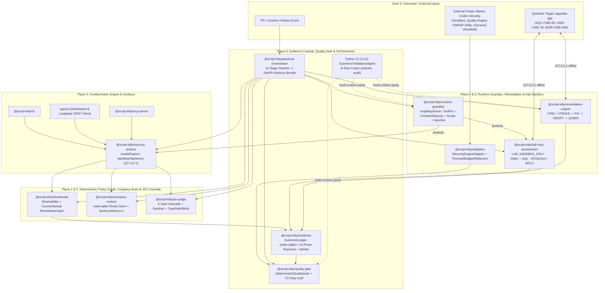
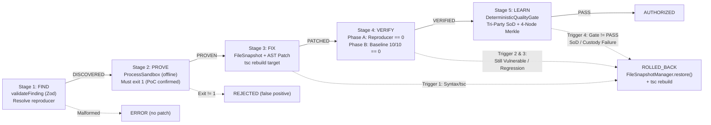
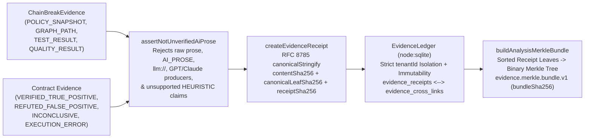

# ScriptKitty 2.0 & ScriptKitty Live — Master Unified Technical Architecture Specification

**Document ID:** `SK-SPEC-V2-LIVE-001`  
**Status:** Canonical Architecture Specification (Authoritative Cross-Plane Reference)  
**Primary Workspaces:** [`packages/`](file:///c:/Users/adm/Desktop/Prototipos/Script%20Kitty/package.json) · [`apps/`](file:///c:/Users/adm/Desktop/Prototipos/Script%20Kitty/README.md) · [`fixtures/payments-lab/`](file:///c:/Users/adm/Desktop/Prototipos/Script%20Kitty/fixtures/payments-lab/unsafe-rollout.json)  
**Operational Posture:** Strictly `LAB` / `LAB_SANDBOX_ONLY` · `productionTested: false` · `mergeAllowed: false` · `deployAllowed: false` · `autoApplyAllowed: false`  

---

## Table of Contents

1. [Executive Architectural Synthesis & Design Axioms](#1-executive-architectural-synthesis--design-axioms)
2. [Plane 1: ScriptKitty Live — PatchCat & ChainBreak v0 (`@script-kitty/chainbreak`)](#2-plane-1-scriptkitty-live--patchcat--chainbreak-v0-script-kittychainbreak)
3. [Plane 2: JEV-as-a-Judge v0 & Company Brain v0 (`@script-kitty/jev-judge`, `@script-kitty/company-context`)](#3-plane-2-jev-as-a-judge-v0--company-brain-v0-script-kittyjev-judge-script-kittycompany-context)
4. [Plane 3: Invokta Action Engine & MCP Streamable HTTP (`@script-kitty/security-actions`)](#4-plane-3-invokta-action-engine--mcp-streamable-http-script-kittysecurity-actions)
5. [Plane 4: Autonomous Remediation Engine, AgentSec Runtime Guardian & Zero-Trust Gate](#5-plane-4-autonomous-remediation-engine-agentsec-runtime-guardian--zero-trust-gate)
6. [Plane 5: Kali Linux Verification MCP & Decoupled Ecosystem Adapters](#6-plane-5-kali-linux-verification-mcp--decoupled-ecosystem-adapters)
7. [Plane 6: Unified Evidence Ledger, PatchCat Orchestrator & Multi-Runtime Core](#7-plane-6-unified-evidence-ledger-patchcat-orchestrator--multi-runtime-core)
8. [Cross-Plane Security Boundary Matrix & Provenance Disclosures](#8-cross-plane-security-boundary-matrix--provenance-disclosures)

---

## 1. Executive Architectural Synthesis & Design Axioms

**ScriptKitty 2.0 + ScriptKitty Live** unifies two complementary defensive security architectures inside a single fail-closed monorepo:

1. **AgentSec Policy-Graph & Governance Fabric (Planes 1–3 & 6):** Models identities, AI agents, MCP tools, APIs, services, data classifications, and destinations as a deterministic directed policy graph ([`@script-kitty/chainbreak`](file:///c:/Users/adm/Desktop/Prototipos/Script%20Kitty/packages/chainbreak/src/index.ts)), routes ambiguous triage decisions through an isolated, scrubbed probabilistic advisor ([`@script-kitty/jev-judge`](file:///c:/Users/adm/Desktop/Prototipos/Script%20Kitty/packages/jev-judge/src/index.ts)), enforces strict multi-tenant organizational memory and delivery eligibility ([`@script-kitty/company-context`](file:///c:/Users/adm/Desktop/Prototipos/Script%20Kitty/packages/company-context/src/index.ts)), and exposes unified loopback capabilities through a single Invokta Action Engine ([`@script-kitty/security-actions`](file:///c:/Users/adm/Desktop/Prototipos/Script%20Kitty/packages/security-actions/src/index.ts)).
2. **Closed-Loop Autonomous AppSec Remediation & MCP Runtime Defense (Planes 4–6):** Proves code-level exploits offline in isolated sandboxes before touching a byte on disk, synthesizes symmetric AST forward/reverse diffs with four automated rollback triggers ([`@script-kitty/remediation-engine`](file:///c:/Users/adm/Desktop/Prototipos/Script%20Kitty/packages/remediation-engine/src/index.ts)), shields live MCP servers and clients against tool poisoning, prompt injection, scope escapes, and confused-deputy privilege escalation ([`@script-kitty/runtime-guardian`](file:///c:/Users/adm/Desktop/Prototipos/Script%20Kitty/packages/runtime-guardian/src/index.ts)), runs hardened read-only Kali verification profiles ([`@script-kitty/kali-mcp-assessment`](file:///c:/Users/adm/Desktop/Prototipos/Script%20Kitty/packages/kali-mcp-assessment/src/index.ts)), binds all evidence inside an RFC 8785 + binary Merkle ledger ([`@script-kitty/evidence`](file:///c:/Users/adm/Desktop/Prototipos/Script%20Kitty/packages/evidence/src/index.ts)), and coordinates the end-to-end human-gated advisory pipeline via [`@script-kitty/patchcat-orchestrator`](file:///c:/Users/adm/Desktop/Prototipos/Script%20Kitty/packages/patchcat-orchestrator/src/index.ts).

### 1.1 Six-Plane System Architecture & Trust Zones



### 1.2 Non-Negotiable Safety & Epistemic Invariants

Every plane obeys six inviolable architectural constraints enforced at runtime by **Zod** schemas, static allowlists, cryptographic digests, and TypeScript literal types:

1. **No Autonomous Production Execution, Merge, or Deployment:**
   - ChainBreak locks [`ExecutionScopeSchema`](file:///c:/Users/adm/Desktop/Prototipos/Script%20Kitty/packages/chainbreak/src/schemas.ts#L280-L300) to `mode: 'LAB'`, `allowProductionExecution: false`, and `allowAutoMergeOrDeploy: false`.
   - JEV locks [`AdjudicationResultSchema`](file:///c:/Users/adm/Desktop/Prototipos/Script%20Kitty/packages/jev-judge/src/schemas.ts#L255-L294) to `mergeAllowed: false`, `deployAllowed: false`, `exploitConfirmed: false`, and `p0DefinedByJevAlone: false`.
   - Company Brain locks [`FACTORY_DELIVERY_POLICY`](file:///c:/Users/adm/Desktop/Prototipos/Script%20Kitty/packages/company-context/src/schemas.ts#L61-L82) and [`FactoryDeliveryEligibilityResultSchema`](file:///c:/Users/adm/Desktop/Prototipos/Script%20Kitty/packages/company-context/src/schemas.ts#L408-L423) to `externalExecution: false`, `mergeAllowed: false`, `deployAllowed: false`, and `deploymentAllowed: false`.
   - RemediationEngine and ChainBreak lock `RemediationSpec` to `requiresHumanApproval: true` and `autoApplyAllowed: false`.
   - PatchCat Orchestrator locks [`ZenPrBundleSchema`](file:///c:/Users/adm/Desktop/Prototipos/Script%20Kitty/packages/patchcat-orchestrator/src/schemas.ts#L131-L175) to `policyMutationAllowed: false`, `gateMutationAllowed: false`, `autoApplyAllowed: false`, `mergeAllowed: false`, `deployAllowed: false`, and `requiresHumanApproval: true`.
2. **`PATH_VALIDATED` $\ne$ `EXPLOIT_CONFIRMED`:** ChainBreak v0 strictly forbids `'EXPLOIT_CONFIRMED'` in [`FindingStatusSchema`](file:///c:/Users/adm/Desktop/Prototipos/Script%20Kitty/packages/chainbreak/src/schemas.ts#L158-L164). Graph reachability establishes policy violation within the modeled snapshot (`PATH_VALIDATED`), never live production exploitability.
3. **Probabilistic Models Never Gate Decisions & Unverified AI Prose Never Acts as Proof:** LLM triage (JEV) is advisory only, pre-gated by deterministic cascade rules, and explicitly marked `thresholdCalibrated: false`. Meanwhile, [`@script-kitty/evidence`](file:///c:/Users/adm/Desktop/Prototipos/Script%20Kitty/packages/evidence/src/crypto.ts#L110-L252) rejects raw prose, `AI_PROSE`/`LLM_SUMMARY` kinds, LLM producers, `llm://` source references, and unsupported `HEURISTIC` claims with `UnverifiedAiProseError` (`UNVERIFIED_AI_PROSE_REJECTED`).
4. **Tri-Party Separation of Duties (SoD):** No single identity may simultaneously discover, verify, and authorize:
   $$A_{\text{disc}} \ne A_{\text{veri}} \land A_{\text{veri}} \ne A_{\text{auth}} \land A_{\text{disc}} \ne A_{\text{auth}}$$
5. **Fail-Closed Everything:** Missing tenant scopes, invalid fixtures, unpinned container digests, `HARNESS2_EXPERIMENTS_ENABLED=true` safety boundaries, missing Kali sandboxes in `LIVE_CONTAINER` mode, leaked credentials in sanitized JEV payloads, expired exceptions, or hash/Merkle mismatches immediately fail closed with typed error codes.
6. **RFC 8785 Canonical JSON + SHA-256 + Binary Merkle Custody:** Every security finding, evidence receipt, patch proposal, gate decision, runtime guardian interception, and orchestration bundle is normalized via lexicographically sorted key-value JSON (`canonicalStringify`) and sealed with SHA-256 hash chaining and logarithmic binary Merkle inclusion proofs.

---

## 2. Plane 1: ScriptKitty Live — PatchCat & ChainBreak v0 (`@script-kitty/chainbreak`)

Entrypoint: [`packages/chainbreak/src/index.ts`](file:///c:/Users/adm/Desktop/Prototipos/Script%20Kitty/packages/chainbreak/src/index.ts) · Schemas: [`packages/chainbreak/src/schemas.ts`](file:///c:/Users/adm/Desktop/Prototipos/Script%20Kitty/packages/chainbreak/src/schemas.ts) · Analyzer: [`packages/chainbreak/src/analyzer.ts`](file:///c:/Users/adm/Desktop/Prototipos/Script%20Kitty/packages/chainbreak/src/analyzer.ts) · Reachability: [`packages/chainbreak/src/reachability.ts`](file:///c:/Users/adm/Desktop/Prototipos/Script%20Kitty/packages/chainbreak/src/reachability.ts) · Remediation: [`packages/chainbreak/src/remediation.ts`](file:///c:/Users/adm/Desktop/Prototipos/Script%20Kitty/packages/chainbreak/src/remediation.ts)

### 2.1 Directed Policy Graph Data Model (`chainbreak.graph.v1`)

ChainBreak models organizational access paths as a typed, tenant-scoped property graph $G = (V, E)$:

* **Vertices (`AttackGraphNodeSchema`):** 7 discrete node kinds:
  `identity` | `agent` | `mcp_tool` | `api` | `service` | `data_asset` | `destination`
  Each node binds `tenantId`, `scope`, optional `allowedScopes`, `roles`, `trustZone` (`INTERNAL` | `DMZ` | `EXTERNAL`), non-empty `sourceRef`, and optional `dataClassification` / `allowedClassifications` on a strict 4-tier lattice:
  $$\text{PUBLIC} \prec \text{INTERNAL} \prec \text{CONFIDENTIAL} \prec \text{RESTRICTED}$$
* **Edges (`AttackGraphEdgeSchema`):** 6 traversal edge kinds:
  `can_invoke` | `can_read` | `can_write` | `transfers_data_to` | `assumes_role` | `delegates_to`
  Every canonical edge carries `edgeId`, `from`, `to`, `kind`, `tenantId`, `scope`, `conditions`, `dataClassification`, non-empty `sourceRef`, and non-empty `policyVersion`. On raw input (`PolicyGraphEdgeInputSchema`), missing `sourceRef` or `policyVersion` defaults to `''` rather than crashing at parse time, allowing the reachability engine to downgrade any affected path to `INCONCLUSIVE` with `missingReferences`.

### 2.2 Transition Semantics & Constraint Evaluation

A traversal state tracks active identity principals, accumulated roles, granted scopes, `mfaVerified`, `piiMaskingApplied`, highest carried data sensitivity `carriedClassification`, edge provenance, and taint/missing-reference flags. For any edge $e = (u \to v)$, traversal in [`reachability.ts`](file:///c:/Users/adm/Desktop/Prototipos/Script%20Kitty/packages/chainbreak/src/reachability.ts) evaluates transitions deterministically:

1. **Tenant & Activation Guard:** $u.\text{tenantId} = v.\text{tenantId} = e.\text{tenantId} = \text{graph.tenantId}$. Inactive edges (`conditions.active === false`) are non-traversable.
2. **Explicit `DENY` Short-Circuit:** If `e.conditions.effect === 'DENY'`, traversal along $e$ terminates immediately.
3. **Principal & Authorization Satisfaction:**
   - All `requiredRoles` must intersect active identity/assumed roles (via `assumes_role`).
   - All `requiredScopes` must be granted within scope constraints.
   - If `requiresMfa === true`, state must satisfy `mfaVerified === true`.
   - If `requiresPiiMasking === true`, state must satisfy `piiMaskingApplied === true`.
4. **Sensitivity Lattice Propagation:** Traversing `can_read` or `transfers_data_to` from/to a `data_asset` propagates `max(carriedClassification, asset.dataClassification)`. When entering an `EXTERNAL` `destination`, the engine tests active organizational policy rules (e.g., `NO_RESTRICTED_DATA_EXTERNAL_TRANSFER`: `RESTRICTED` data reaching an `EXTERNAL` node without masking/deny/exception).

### 2.3 `PATH_VALIDATED` Invariants & Epistemic Status Rules

| `FindingStatus` | Exact Meaning in ChainBreak v0 | Conditions |
|---|---|---|
| **`PATH_VALIDATED`** | Deterministic reachability + active policy breach proven within modeled graph | All traversed edges and nodes carry non-empty `sourceRef` and `policyVersion`; `inputSha256` intact |
| **`INCONCLUSIVE`** | Potential path exists, but supporting evidence or policy refs are incomplete | Missing `sourceRef` or `policyVersion` on $\ge 1$ edge/node (`missingReferences.length > 0`, `riskRecommendation: 'UNDETERMINED'`) |
| **`POTENTIAL`** | Candidate vector matching heuristic/edge pattern pending full constraint proof | Reserved prior to constraint closure |
| **`NOT_REPRODUCED`** | Candidate path disproven under active controls or condition mismatches | Evaluated constraints block traversal (e.g., negative control) |
| ~~`EXPLOIT_CONFIRMED`~~ | **FORBIDDEN IN SCHEMA** | Rejected by `FindingStatusSchema` (`superRefine`/enum exclusion) |

### 2.4 Bounded Execution Scope & Allowlisted Fixtures

[`ExecutionScopeSchema`](file:///c:/Users/adm/Desktop/Prototipos/Script%20Kitty/packages/chainbreak/src/schemas.ts#L280-L300) prevents DoS graph explosions and accidental host/production execution:
* `mode`: locked literal `'LAB'`
* `allowedFixtures`: `'payments-lab/baseline'`, `'payments-lab/unsafe-rollout'`, `'payments-lab/remediated'`, `'payments-lab/negative-control'` (`ChainBreakError('DISALLOWED_FIXTURE')` on any unknown fixture before reading disk)
* Graph search bounds: `maxNodes <= 10_000` (default `500`), `maxDepth <= 64` (default `12`), `maxPaths <= 500` (default `50`), `maxDurationMs <= 30_000` (default `5_000`)
* Tamper integrity: `computePolicyGraphSha256` validates input hashes against caller expectations, throwing `TAMPER_DETECTED` or `TENANT_MISMATCH` fail-closed.

### 2.5 Counterfactual Minimal Remediation Synthesis & Payments Lab Walkthrough

For every `PATH_VALIDATED` path, [`remediation.ts`](file:///c:/Users/adm/Desktop/Prototipos/Script%20Kitty/packages/chainbreak/src/remediation.ts) simulates candidate edge mutations (`REMOVE_EDGE`, `RESTRICT_DATA_CLASSIFICATION`, `RESTRICT_SCOPE`, `ADD_DENY_CONDITION`) inside an in-memory graph clone and executes reachability on the counterfactual graph. A candidate `RemediationSpec` is emitted **only** when:
1. `breaksUnauthorizedPath === true` (forbidden path count drops to `0`),
2. `preservesLegitimateOperations === true` (all declared `legitimateOperations` continue resolving cleanly), and
3. Governance flags remain locked (`requiresHumanApproval: true`, `autoApplyAllowed: false`).

| Payments Lab Fixture ([`fixtures/payments-lab/`](file:///c:/Users/adm/Desktop/Prototipos/Script%20Kitty/fixtures/payments-lab/unsafe-rollout.json)) | Scenario Role | Forbidden Paths | Legitimate Ops Preserved | Key Edge / Policy Verdict |
|---|---|---|---|---|
| [`baseline.json`](file:///c:/Users/adm/Desktop/Prototipos/Script%20Kitty/fixtures/payments-lab/baseline.json) | Clean baseline | `0` | `3 / 3` (`true`) | Compliant nominal state |
| [`unsafe-rollout.json`](file:///c:/Users/adm/Desktop/Prototipos/Script%20Kitty/fixtures/payments-lab/unsafe-rollout.json) | Unsafe `report-exporter` rollout | `1` | Checked via remediation | `PATH_VALIDATED` (`P1`), policy `NO_RESTRICTED_DATA_EXTERNAL_TRANSFER`, culprit edge `e-rollout-exporter-read-pii` (`report-exporter-rollout.yaml#L24`) |
| [`remediated.json`](file:///c:/Users/adm/Desktop/Prototipos/Script%20Kitty/fixtures/payments-lab/remediated.json) | Post-counterfactual fix | `0` | `3 / 3` (`true`) | Unauthorized `RESTRICTED` PII path severed; business ops intact |
| [`negative-control.json`](file:///c:/Users/adm/Desktop/Prototipos/Script%20Kitty/fixtures/payments-lab/negative-control.json) | Unsatisfied edge guards | `0` | N/A | Non-matching conditions produce zero false-positive paths |

---

## 3. Plane 2: JEV-as-a-Judge v0 & Company Brain v0 (`@script-kitty/jev-judge`, `@script-kitty/company-context`)

### 3.1 JEV-as-a-Judge v0 Advisory Cascade (`@script-kitty/jev-judge`)

Entrypoint: [`packages/jev-judge/src/index.ts`](file:///c:/Users/adm/Desktop/Prototipos/Script%20Kitty/packages/jev-judge/src/index.ts) · Schemas: [`packages/jev-judge/src/schemas.ts`](file:///c:/Users/adm/Desktop/Prototipos/Script%20Kitty/packages/jev-judge/src/schemas.ts) · Sanitizer: [`packages/jev-judge/src/sanitizer.ts`](file:///c:/Users/adm/Desktop/Prototipos/Script%20Kitty/packages/jev-judge/src/sanitizer.ts) · Client: [`packages/jev-judge/src/typesafe-provider.ts`](file:///c:/Users/adm/Desktop/Prototipos/Script%20Kitty/packages/jev-judge/src/typesafe-provider.ts) · Pipeline: [`packages/jev-judge/src/pipeline.ts`](file:///c:/Users/adm/Desktop/Prototipos/Script%20Kitty/packages/jev-judge/src/pipeline.ts)

JEV-as-a-Judge provides structured probabilistic triage strictly bounded behind deterministic gates so an LLM can **never** elevate permissions, hide missing evidence, certify an exploit, or bypass human review:

```mermaid
sequenceDiagram
    autonumber
    participant Caller as Caller / ActionEngine
    participant PreVal as Deterministic Cascade<br/>(5 Pre-Validation Checks)
    participant San as sanitizeStateForJev<br/>(jev.sanitized.state.v1)
    participant Prov as TypeSafeClient (/v1/systemone)<br/>or MockTypeSafeJevProvider
    participant Esc as JevEscalationPolicy<br/>+ Deterministic Floor

    Caller->>PreVal: SecurityAnalysis + ExecutionScope + PolicyContext
    Note over PreVal: 1. identityAndTenantScope<br/>2. labModeBoundary<br/>3. hashIntegrity<br/>4. evidenceCompletenessAndVerification<br/>5. policyAndSourceRefs
    alt Blocking Pre-Validation Failure
        PreVal-->>Caller: AdjudicationResult (BLOCKED or REJECTED; provider NOT invoked)
    else Pre-Validation Passes
        PreVal->>San: Strip raw code, secrets, URLs, paths
        alt Sensitive Token Detected in Sanitized Output
            San-->>Caller: Throw SANITIZATION_FAILED (fail closed)
        else Clean Sanitized State
            San->>Prov: Rubric 'jev-rubric-v0' (evidence_sufficient[noul], needs_manual_review[noul], triage[choice])
            Prov-->>Esc: AtomicJevAnswers + providerStatus (LIVE vs NOT_CONFIGURED/MOCK)
            Esc->>Esc: Check thresholds (conf>=0.75, suff>=0.75, manualReview<0.5)<br/>& computeDeterministicRiskRecommendation
            Esc-->>Caller: AdjudicationResult (PENDING_REVIEW / ACCEPTED_FOR_TRIAGE;<br/>mergeAllowed=false, deployAllowed=false, exploitConfirmed=false, thresholdCalibrated=false)
        end
    end
```

#### Atomic Question Rubric & Escalation Policy
* **Rubric Version (`JEV_RUBRIC_VERSION = 'jev-rubric-v0'`):** Forces decomposed atomic schema outputs (`AtomicJevAnswersSchema`) instead of open-ended model essays:
  1. `evidence_sufficient`: `{ type: 'noul', noul: number }` $\in [0, 1]$
  2. `needs_manual_review`: `{ type: 'noul', noul: number }` $\in [0, 1]$
  3. `triage`: `{ type: 'choice', choice: 'likely_actionable' | 'needs_more_evidence' | 'likely_irrelevant', confidence: number, probabilities: Record<string, number> }`
* **Confidence vs Calibration Transparency:** Every response includes `confidenceOrUncertainty` with **`thresholdCalibrated: false`** and an explicit `calibrationNote`, preventing uncalibrated softmax/heuristic scores from impersonating statistically calibrated probabilities.
* **Escalation Policy Defaults (`JevEscalationPolicyConfigSchema`):**
  `confidenceThreshold: 0.75`, `evidenceSufficiencyThreshold: 0.75`, `manualReviewThreshold: 0.5`, `escalateOnCriticalRisk: true`, `fallbackOnProviderError: 'HUMAN_PENDING'`. Whenever confidence or sufficiency drops below threshold, manual review exceeds threshold, provider status is `NOT_CONFIGURED`/`UNAVAILABLE`, or risk is `P0`/`P1`, JEV routes deterministically to **`PENDING_REVIEW`** (or `INCONCLUSIVE`).
* **External Provider Boundary (`TypeSafeClient`):** Uses native Node `fetch` against `${baseURL}/v1/systemone` with `Authorization: Bearer ${TYPESAFE_API_KEY}` (`@typesafe-ai/sdk` npm package is not installed; client implements wire-compatible JSON over HTTPS). Absent `TYPESAFE_API_KEY`, `resolveDefaultJevProvider` honestly resolves to `MockTypeSafeJevProvider` (`decisionSource: 'MOCK'`, `providerStatus: 'NOT_CONFIGURED'`).

---

### 3.2 Company Brain v0 & `factory.delivery.v1` (`@script-kitty/company-context`)

Entrypoint: [`packages/company-context/src/index.ts`](file:///c:/Users/adm/Desktop/Prototipos/Script%20Kitty/packages/company-context/src/index.ts) · Schemas: [`packages/company-context/src/schemas.ts`](file:///c:/Users/adm/Desktop/Prototipos/Script%20Kitty/packages/company-context/src/schemas.ts) · Store: [`packages/company-context/src/store.ts`](file:///c:/Users/adm/Desktop/Prototipos/Script%20Kitty/packages/company-context/src/store.ts)

`CompanyBrainStore` persists organizational context, versioned policies, context items, analysis snapshots, JEV adjudications, and remediation specs inside Node 22 `node:sqlite` (`DatabaseSync` configured with WAL journaling and `busy_timeout`).

* **Multi-Tenant & Actor Boundaries:**
  - Every query and mutation requires explicit `(authTenantId, principal)` credentials.
  - Cross-tenant reads, writes, context links, or policy mutations raise **`TenantIsolationError`** (`TENANT_ISOLATION_VIOLATION`).
  - Unauthorized caller roles raise **`ActorAuthorizationError`** (`ACTOR_UNAUTHORIZED`).
* **Policy Lifecycle & Safe Rollback:** Policies (`PolicyRecord`) maintain immutable SHA-256 content snapshots with monotonic versions and an atomic `active` pointer, supporting deterministic rollback without losing historical auditability.
* **`factory.delivery.v1` Eligibility Contract ([`schemas.ts#L61-L423`](file:///c:/Users/adm/Desktop/Prototipos/Script%20Kitty/packages/company-context/src/schemas.ts#L61-L423)):**
  - Enforces bounded submission policies (`FACTORY_DELIVERY_POLICY`: `deadlineHours: 24`, `maxSubmissions: 4`, `requiredChecks: ['tests', 'typecheck', 'build']`).
  - Validates snapshot freshness (`!cancelled`, deadline not expired, `submissions` within `0..4`), clean artifact & review status, and tri-role authority activation (`requesterActive`, `submitterActive`, `reviewerActive`, `enabled`).
  - Returns `FactoryDeliveryEligibilityResult` carrying `eligible`, `stage`, `blockReason`, `submissionsRemaining`, `correctionsRemaining`, optional `commitSha`, and immutable non-execution flags (`externalExecution: false`, `mergeAllowed: false`, `deployAllowed: false`, `deploymentAllowed: false`).

---

## 4. Plane 3: Invokta Action Engine & MCP Streamable HTTP (`@script-kitty/security-actions`)

Entrypoint: [`packages/security-actions/src/index.ts`](file:///c:/Users/adm/Desktop/Prototipos/Script%20Kitty/packages/security-actions/src/index.ts) · Engine: [`engine.ts`](file:///c:/Users/adm/Desktop/Prototipos/Script%20Kitty/packages/security-actions/src/engine.ts) · Capabilities: [`capabilities.ts`](file:///c:/Users/adm/Desktop/Prototipos/Script%20Kitty/packages/security-actions/src/capabilities.ts) · HTTP Transport: [`mcp-http.ts`](file:///c:/Users/adm/Desktop/Prototipos/Script%20Kitty/packages/security-actions/src/mcp-http.ts) · Client: [`mcp-client.ts`](file:///c:/Users/adm/Desktop/Prototipos/Script%20Kitty/packages/security-actions/src/mcp-client.ts)

### 4.1 Single Execution Path (`createEngine` / `defineCapability` / `engine.invoke`)

To eliminate split-brain authorization bugs between CLI invocations, web UI dashboards, and HTTP MCP transports, every Live action routes through a single runtime pipeline in [`engine.ts`](file:///c:/Users/adm/Desktop/Prototipos/Script%20Kitty/packages/security-actions/src/engine.ts):

1. Principal validation (`AuthPrincipal`: non-empty `principalId`, `tenantId`, `roles`, `scopes`).
2. Strict scope allowlisting per capability (`requiredScopes`).
3. Strict Zod input & output parsing.
4. Tenant-isolated persistence into `CompanyBrainStore`.
5. Unified invocation returning canonical typed outputs regardless of `in_process` vs `mcp_http` transport (`ActionEngineError` on validation/auth/rate violations).

### 4.2 Registered Action Capabilities

| Capability ID | Required Scope | Core Behavior & Underlying Package Calls |
|---|---|---|
| `security.chainbreak.analyze` | `security:analyze` | Runs `analyzeFixture` / `analyzePolicyGraph` in `LAB` mode, records analysis + evidence snapshots in `CompanyBrainStore`, returns `SecurityAnalysis`. |
| `security.chainbreak.get` | `security:read` | Retrieves a previously persisted `SecurityAnalysis` scoped strictly to the authenticated caller's `tenantId`. |
| `security.judge.evaluate` | `security:judge` | Evaluates an analysis via `evaluateWithJevJudge`, records `AdjudicationResult` in `CompanyBrainStore`, preserves `PENDING_REVIEW` and non-merge bounds. |
| `security.remediation.spec` | `security:remediate` | Extracts or synthesizes counterfactual minimal `RemediationSpec[]` (`requiresHumanApproval: true`, `autoApplyAllowed: false`). |
| `security.status` | `security:status` | Reports non-sensitive engine health, capabilities list, provider configuration state (`LIVE` vs `NOT_CONFIGURED`), and tenant record counts. |

### 4.3 Hardened Loopback Streamable HTTP Server (`127.0.0.1`) & Client Surfaces

[`startMcpHttpServer`](file:///c:/Users/adm/Desktop/Prototipos/Script%20Kitty/packages/security-actions/src/mcp-http.ts) implements Streamable HTTP JSON-RPC 2.0 (`tools/list`, `tools/call`) alongside `GET /health` and `POST /mcp` with explicit transport defenses:

* **Strict Loopback Binding:** Listens exclusively on `127.0.0.1` (non-loopback hosts blocked fail-closed).
* **Bearer Auth & Principal Binding:** Validates constant-time Bearer token against per-token `AuthPrincipal` records (`401 UNAUTHORIZED` on missing/bad token, `403 FORBIDDEN` on insufficient scope).
* **DNS Rebinding & Origin Protection:** Validates `Host` and `Origin` headers against explicit allowlists (`403` on untrusted origins).
* **Bounded Requests & Sliding-Window Rate Limiting:** Enforces payload byte limits (`400`) and per-principal sliding-window quotas (`429 RATE_LIMITED`).
* **Surface Consumers:**
  - **UI Dashboard ([`apps/ui`](file:///c:/Users/adm/Desktop/Prototipos/Script%20Kitty/apps/ui/src/live-controller.ts)):** [`mcp-browser-client.ts`](file:///c:/Users/adm/Desktop/Prototipos/Script%20Kitty/apps/ui/src/mcp-browser-client.ts) (`validateLoopbackMcpUrl`) enforces fail-closed loopback SSRF checks (`127.0.0.1` / `localhost` / `::1` only, embedded URL credentials banned); [`dashboard-view.ts`](file:///c:/Users/adm/Desktop/Prototipos/Script%20Kitty/apps/ui/src/dashboard-view.ts) renders interactive EN/PT/ES views over PatchCat & ChainBreak state with HTML escaping (`escapeHtml`).
  - **CLI & Legacy/Lab MCP Server:** [`apps/cli`](file:///c:/Users/adm/Desktop/Prototipos/Script%20Kitty/apps/cli/src/index.ts) (`real_scanner.ts` secret/SAST/header inspection with credential masking via [`credentials.ts`](file:///c:/Users/adm/Desktop/Prototipos/Script%20Kitty/apps/cli/src/credentials.ts)) and [`apps/mcp-server`](file:///c:/Users/adm/Desktop/Prototipos/Script%20Kitty/apps/mcp-server/src/index.ts) ([`scanner.ts`](file:///c:/Users/adm/Desktop/Prototipos/Script%20Kitty/apps/mcp-server/src/scanner.ts) integrated with `RuntimeGuardian`).

---

## 5. Plane 4: Autonomous Remediation Engine, AgentSec Runtime Guardian & Zero-Trust Gate

### 5.1 Closed-Loop Autonomous Remediation Engine (`@script-kitty/remediation-engine`)

Entrypoint: [`packages/remediation-engine/src/index.ts`](file:///c:/Users/adm/Desktop/Prototipos/Script%20Kitty/packages/remediation-engine/src/index.ts) · Lifecycle: [`lifecycle.ts`](file:///c:/Users/adm/Desktop/Prototipos/Script%20Kitty/packages/remediation-engine/src/lifecycle.ts) · Sandbox: [`sandbox.ts`](file:///c:/Users/adm/Desktop/Prototipos/Script%20Kitty/packages/remediation-engine/src/sandbox.ts) · Patcher: [`patcher.ts`](file:///c:/Users/adm/Desktop/Prototipos/Script%20Kitty/packages/remediation-engine/src/patcher.ts) · Rechecker: [`rechecker.ts`](file:///c:/Users/adm/Desktop/Prototipos/Script%20Kitty/packages/remediation-engine/src/rechecker.ts) · Rollback: [`rollback.ts`](file:///c:/Users/adm/Desktop/Prototipos/Script%20Kitty/packages/remediation-engine/src/rollback.ts)



#### Offline Sandbox & Dual-Phase Verification Guarantees
* **`ProcessSandbox.runScript` ([`sandbox.ts`](file:///c:/Users/adm/Desktop/Prototipos/Script%20Kitty/packages/remediation-engine/src/sandbox.ts)):** Executes `process.execPath` directly (`shell: false`), scrubs proxy env vars (`HTTP_PROXY`, `HTTPS_PROXY`, `ALL_PROXY`, `FTP_PROXY`, `CURL_PROXY`), injects `SCRIPTKITTY_OFFLINE='1'` and `NO_PROXY='*'`, strips host secrets via minimal env allowlist, caps `stdout`/`stderr` at `1 MiB`, and kills hung runs with `SIGKILL` returning exit `124` (`timeoutMs` default `30,000 ms`).
* **Diff Symmetry & Snapshot Containment ([`patcher.ts`](file:///c:/Users/adm/Desktop/Prototipos/Script%20Kitty/packages/remediation-engine/src/patcher.ts), [`rollback.ts`](file:///c:/Users/adm/Desktop/Prototipos/Script%20Kitty/packages/remediation-engine/src/rollback.ts)):** `FileSnapshotManager` stores exact UTF-8 pre-image bytes and SHA-256 checksums before disk mutation; `Patcher` builds forward unified diffs (`generateUnifiedDiff`) and mathematically exact inverse diffs (`generateReverseDiff`), recording blast radius (`files_modified`, `lines_added`, `lines_deleted`, `ast_impact_scope`, `breaking_change_risk`).
* **Synthetic Vulnerable Target ([`apps/lab-app`](file:///c:/Users/adm/Desktop/Prototipos/Script%20Kitty/apps/lab-app/src/index.ts)):** Native `node:http` + `node:sqlite` service bound to `127.0.0.1` exercising 3 reproducible vulnerability paths and 10 baseline functional tests ([`baseline.test.mts`](file:///c:/Users/adm/Desktop/Prototipos/Script%20Kitty/apps/lab-app/tests/baseline.test.mts)):
  - **SQL Injection (`CWE-89`):** [`search.ts`](file:///c:/Users/adm/Desktop/Prototipos/Script%20Kitty/apps/lab-app/src/routes/search.ts) + [`repro-sqli.mts`](file:///c:/Users/adm/Desktop/Prototipos/Script%20Kitty/apps/lab-app/repro/repro-sqli.mts) (interpolated `LIKE '%${query}%'` $\to$ parameterized `LIKE ?`).
  - **OS Command Injection (`CWE-78`):** [`diagnostics.ts`](file:///c:/Users/adm/Desktop/Prototipos/Script%20Kitty/apps/lab-app/src/routes/diagnostics.ts) + [`repro-cmdi.mts`](file:///c:/Users/adm/Desktop/Prototipos/Script%20Kitty/apps/lab-app/repro/repro-cmdi.mts) (raw host command $\to$ strict `HOSTNAME_REGEX = /^[a-zA-Z0-9.-]+$/`).
  - **Broken Access Control / IDOR (`CWE-639`):** [`reports.ts`](file:///c:/Users/adm/Desktop/Prototipos/Script%20Kitty/apps/lab-app/src/routes/reports.ts) + [`repro-idor.mts`](file:///c:/Users/adm/Desktop/Prototipos/Script%20Kitty/apps/lab-app/repro/repro-idor.mts) (`x-user-id` owner/admin enforcement $\to$ `403 Forbidden`).

---

### 5.2 AgentSec Runtime Guardian (`@script-kitty/runtime-guardian`)

Entrypoint: [`packages/runtime-guardian/src/index.ts`](file:///c:/Users/adm/Desktop/Prototipos/Script%20Kitty/packages/runtime-guardian/src/index.ts) · Middleware: [`middleware.ts`](file:///c:/Users/adm/Desktop/Prototipos/Script%20Kitty/packages/runtime-guardian/src/middleware.ts)

[`RuntimeGuardian`](file:///c:/Users/adm/Desktop/Prototipos/Script%20Kitty/packages/runtime-guardian/src/middleware.ts#L28-L321) instruments both MCP servers via [`wrapMcpServer(server, guardian)`](file:///c:/Users/adm/Desktop/Prototipos/Script%20Kitty/packages/runtime-guardian/src/middleware.ts#L331-L474) (wrapping `tools/list`, `tools/call`, and future `setRequestHandler` registrations) and direct tool executors via [`createGuardianClientInterceptor(guardian)`](file:///c:/Users/adm/Desktop/Prototipos/Script%20Kitty/packages/runtime-guardian/src/middleware.ts#L479-L513), defaulting to `failClosed: true`:

| Guard Module | Hook(s) | Core Enforcement & Error Codes |
|---|---|---|
| **1. [`ToolPoisoningGuard`](file:///c:/Users/adm/Desktop/Prototipos/Script%20Kitty/packages/runtime-guardian/src/tool-poisoning.ts)** | `onListTools`, `onCallTool` | Computes RFC 8785 + SHA-256 `computeToolDefinitionHash` over `{ name, description, inputSchema }`. Blocks `E_INVALID_SCHEMA`, `E_DUPLICATE_TOOL` (shadow tools), `E_UNREGISTERED_TOOL`, `E_DESCRIPTION_POISONING` (hidden instructions), and `E_TOOL_HASH_DRIFT`. |
| **2. [`ConfusedDeputyGuard`](file:///c:/Users/adm/Desktop/Prototipos/Script%20Kitty/packages/runtime-guardian/src/confused-deputy.ts)** | `onCallTool` | Enforces live SoD on verification tools (`verify_finding`, `run_recheck` -> `E_SOD_SELF_CERTIFICATION`); blocks tainted callers (`is_tainted` / `taint_tags`) from state-changing tools unless `dry_run === true` (`E_TAINTED_CALLER_PRIVILEGE_VIOLATION`); verifies HMAC-SHA256 delegation tokens (`<= 300,000 ms` TTL, $\pm 2,000\text{ ms}$ skew, nonce replay cache, subject/audience/scope match). |
| **3. [`ScopeBoundaryGuard`](file:///c:/Users/adm/Desktop/Prototipos/Script%20Kitty/packages/runtime-guardian/src/scope-guard.ts)** | `onCallTool` | Walks nested payloads up to depth `20` / `10,000` nodes (`E_SCOPE_PAYLOAD_TOO_COMPLEX`). Nine-step path validator rejects null bytes/controls (`E_PATH_NULL_BYTE`), double URL encoding (`E_PATH_DOUBLE_ENCODING`), `NFKC` fullwidth tricks, disallowed schemes (`allowedUriSchemes: ['file', 'sqlite']` -> `E_INVALID_URI_SCHEME`), UNC network shares (`E_PATH_UNC_FORBIDDEN`), NTFS ADS streams (`E_PATH_NTFS_ADS`), out-of-bounds symlink escapes via `fs.realpathSync.native` (`E_PATH_OUT_OF_BOUNDS`), and dotfiles/keys (`.git`, `.env*`, `id_rsa`, `.aws/credentials`, `*.pem/*.key`, `/etc/passwd` -> `E_SENSITIVE_RESOURCE_BLOCKED`). |
| **4. [`PromptInjectionDetector`](file:///c:/Users/adm/Desktop/Prototipos/Script%20Kitty/packages/runtime-guardian/src/prompt-injection.ts)** | `onCallTool`, `onToolResult` | Detects zero-width/BiDi chars (`E_OBFUSCATION_CHARS`), normalizes leetspeak, **always blocks** (even in `'SANITIZE'` mode) behavioral overrides (`E_BEHAVIORAL_OVERRIDE`) and exfiltration/IMDS targets (`webhook.site`, `169.254.169.254`, `metadata.google.internal`, `100.100.100.200`, markdown image leaks -> `E_EXFILTRATION_PAYLOAD`), and sanitizes delimiters & leaked credentials (`AKIA...`, `ghp_...`, `sk-...`, PEM keys) before tool output reaches caller LLM context. |

Every `ON_LIST_TOOLS`, `ON_CALL_TOOL`, and `ON_TOOL_RESULT` decision appends a serialized record to [`InMemoryAuditLogger`](file:///c:/Users/adm/Desktop/Prototipos/Script%20Kitty/packages/runtime-guardian/src/audit-logger.ts) or NDJSON `FileAuditLogger` anchored from `GENESIS_0...` via `SHA-256(canonicalStringify(event_i \ {current_hash}) + prev_hash_i)` and summarized with a binary Merkle root.

---

### 5.3 Zero-Trust Gate Predicate Calculus & Cryptographic Custody (`@script-kitty/contracts`, `@script-kitty/quality-gate`)

Contracts: [`packages/contracts/src/index.ts`](file:///c:/Users/adm/Desktop/Prototipos/Script%20Kitty/packages/contracts/src/index.ts) · Custody: [`custody.ts`](file:///c:/Users/adm/Desktop/Prototipos/Script%20Kitty/packages/contracts/src/custody.ts) · Gate: [`packages/quality-gate/src/engine.ts`](file:///c:/Users/adm/Desktop/Prototipos/Script%20Kitty/packages/quality-gate/src/engine.ts) · SoD: [`separation-of-duties.ts`](file:///c:/Users/adm/Desktop/Prototipos/Script%20Kitty/packages/quality-gate/src/separation-of-duties.ts) · Policy: [`policy.ts`](file:///c:/Users/adm/Desktop/Prototipos/Script%20Kitty/packages/quality-gate/src/policy.ts)

[`DeterministicQualityGate`](file:///c:/Users/adm/Desktop/Prototipos/Script%20Kitty/packages/quality-gate/src/engine.ts) computes a deterministic boolean conjunction over seven fail-closed predicates before permitting `GateVerdict.PASS`:

$$G(\text{target}) = P_{\text{schema}} \land P_{\text{policy}} \land P_{\text{scope}} \land P_{\text{evidence}} \land P_{\text{SoD}} \land P_{\text{patch}} \land P_{\text{custody}}$$

* **$P_{\text{schema}}$:** Strict Zod validation on `SecurityFinding`, `Evidence`, `PatchProposal`, `Policy` (`version === 1`, bounded limits `max_file_bytes <= 2 MiB`, `max_files <= 5,000`, `max_total_bytes <= 32 MiB`, `timeout_ms <= 20,000 ms`).
* **$P_{\text{evidence}}$:** Every threshold-breaching (`CRITICAL` / `HIGH` or configured `severity_threshold`) finding must carry independent empirical verification (`VERIFIED_TRUE_POSITIVE` or post-patch `REFUTED_FALSE_POSITIVE` with intact artifact/proof) unless covered by an exact, unexpired exception (`{ rule_id, fingerprint, reason, expires >= todayUTC }`). Unverified findings yield `REQUIRES_HUMAN_APPROVAL` or `BLOCK`—never `PASS`.
* **$P_{\text{SoD}}$ (`validateSeparationOfDuties`):** Evaluates case-insensitive agent identities across `(discoverer, verifier, authorizer)` emitting distinct violation codes: `E_SOD_MISSING_AGENT`, `E_SOD_OMNIPOTENT_AGENT` ($A_{\text{disc}} = A_{\text{veri}} = A_{\text{auth}}$), `E_SOD_SELF_CERTIFICATION` ($A_{\text{disc}} = A_{\text{veri}}$), `E_SOD_SELF_AUTHORIZATION` ($A_{\text{veri}} = A_{\text{auth}}$), `E_SOD_DISCOVERER_AUTHORIZATION` ($A_{\text{disc}} = A_{\text{auth}}$), and `E_SOD_SELF_ASSERTED_EVIDENCE`. Any violation forces `GateVerdict.REJECT` regardless of client fields (`GateDecisionSchema.superRefine`).
* **$P_{\text{patch}}$:** Patch proposals must pass `recheck_status === 'passed_clean'`, carry valid `recheck_evidence_id`, match `patch_sha256`, and include a non-empty `rollback_plan.revert_patch`.
* **$P_{\text{custody}}$ (`buildCustodyChain` / `verifyChainOfCustody`):** Constructs and verifies the 4-node RFC 8785 hash chain starting at `GENESIS_HASH = "GENESIS_" + "0".repeat(64)`:
  $$\text{Node}_0\;(\text{FINDING}) \longrightarrow \text{Node}_1\;(\text{EVIDENCE}) \longrightarrow \text{Node}_2\;(\text{PATCH}) \longrightarrow \text{Node}_3\;(\text{GATE})$$
  and commits leaves $L_0 \dots L_{n-1}$ into a binary Merkle root (`computeMerkleRoot`, odd leaves duplicated cleanly; empty set yields `EMPTY_MERKLE_ROOT = "0".repeat(64)`).

---

## 6. Plane 5: Kali Linux Verification MCP & Decoupled Ecosystem Adapters

### 6.1 Kali Linux Security Verification MCP (`@script-kitty/kali-mcp-assessment`)

Entrypoint: [`packages/kali-mcp-assessment/src/index.ts`](file:///c:/Users/adm/Desktop/Prototipos/Script%20Kitty/packages/kali-mcp-assessment/src/index.ts) · Schemas: [`schemas.ts`](file:///c:/Users/adm/Desktop/Prototipos/Script%20Kitty/packages/kali-mcp-assessment/src/schemas.ts) · Argv Builder: [`argv-builder.ts`](file:///c:/Users/adm/Desktop/Prototipos/Script%20Kitty/packages/kali-mcp-assessment/src/argv-builder.ts) · Capabilities: [`capabilities.ts`](file:///c:/Users/adm/Desktop/Prototipos/Script%20Kitty/packages/kali-mcp-assessment/src/capabilities.ts) · Sandbox Profiles: [`sandbox-profile.ts`](file:///c:/Users/adm/Desktop/Prototipos/Script%20Kitty/packages/kali-mcp-assessment/src/sandbox-profile.ts) · MCP Server: [`server.ts`](file:///c:/Users/adm/Desktop/Prototipos/Script%20Kitty/packages/kali-mcp-assessment/src/server.ts)

[`@script-kitty/kali-mcp-assessment`](file:///c:/Users/adm/Desktop/Prototipos/Script%20Kitty/packages/kali-mcp-assessment/src/index.ts) is locked to **`KALI_MODE = 'LAB_SANDBOX_ONLY'`** and bridges controlled lab verification into ScriptKitty's Zero-Trust custody fabric through 4 strictly allowlisted MCP tools:

| MCP Capability | Purpose | Argv / Mode Constraints |
|---|---|---|
| `security.kali.recon_surface` | Safe loopback port/HTTP metadata discovery | Strictly targets `127.0.0.1`, `localhost`, or `*.localnet`; unique ports (`max 32`); profiles `tcp_connect_ports` \| `http_headers_metadata`. |
| `security.kali.config_audit` | TLS posture, HTTP headers & static config checks | Read-only baseline checks (`tls_posture` \| `http_security_headers` \| `static_config_tree`), `is_state_changing: false`. |
| `security.kali.verify_reproducer` | Execute bounded reproducer verification | Cross-checks `_meta.caller_agent_id` vs `verifier_agent_id` (`E_SOD_CALLER_MISMATCH`) and full Tri-Party SoD (`validateSeparationOfDuties`); binds signed `EngagementScopeRef` (`expires_at > now`). |
| `security.kali.sbom_cve_check` | Offline/pinned dependency & SBOM CVE inspection | Confined strictly to workspace-relative paths via `trivy` / `syft` / `grype` allowlisted tuples. |

#### Zero-Shell Execution & Defense Controls
1. **Static `argv` Construction (`buildSafeKaliArgv`):** Spawns commands exclusively via `execFile(..., { shell: false })` with immutable string arrays containing mandatory POSIX `--` end-of-options markers.
   - **`ALLOWLISTED_KALI_BINARIES`:** `nmap`, `httpx`, `curl`, `testssl.sh`, `trivy`, `syft`, `grype`, `lynis`, `node`, `python3`.
   - **`FORBIDDEN_KALI_BINARIES`:** `sh`, `bash`, `zsh`, `dash`, `ksh`, `fish`, `cmd`, `cmd.exe`, `powershell`, `powershell.exe`, `pwsh`, `msfconsole`, `msfvenom`, `metasploit`, `sqlmap`, `hydra`, `hashcat`, `john`, `johntheripper`, `responder`, `mimikatz`, `medusa`, `hping3`, `nc`, `ncat`, `socat`.
   - **`FORBIDDEN_KALI_FLAGS`:** `-sS`, `-sU`, `-sN`, `-sF`, `-sX`, `-A`, `-O`, `-iL`, `-oN`, `-oG`, `-oA`, `--script`, `--os-shell`, `--os-pwn`, `--exploit`, `--dump-all`, `--reverse-shell`, `--bind-shell`, `-e`, `--eval`, `-c`.
2. **Target Host & SSRF Firewall (`BLOCKED_IMDS_AND_HOST_TARGETS` & `isRfc1918OrLinkLocalIpv4`):** Unconditionally rejects `169.254.169.254`, `169.254.169.253`, `169.254.170.2`, `100.100.100.200`, `metadata.google.internal`, `metadata`, `0.0.0.0`, `host.docker.internal`, `gateway.docker.internal`, `kubernetes.default`, RFC 1918 (`10.0.0.0/8`, `172.16.0.0/12`, `192.168.0.0/16`), link-local (`169.254.0.0/16`), and CGNAT (`100.64.0.0/10`).
3. **Host Credential Stripping:** Scrubs `AWS_*`, `GITHUB_*`, `GH_*`, `CLOUDFLARE_*`, `CF_*`, `OPENAI_*`, `ANTHROPIC_*`, `CLAUDE_*`, `GOOGLE_*`, `GEMINI_*`, `NVIDIA_*`, `OPENROUTER_*`, `GROK_*`, `TYPESAFE_*`, `SLACK_*`, `DOCKER_*`, `SSH_*`, `AZ_*`, `AZURE_*`, `GCP_*`, `NPM_*`, `NPM_TOKEN`, `NODE_AUTH_TOKEN`, and proxy environment variables before launching sandboxed subprocesses.
4. **Hardened Container & Seccomp Artifacts (Honest `LIVE_CONTAINER` vs `LAB_SIMULATION` Status):**
   - **Image Digest Pinning:** `PinnedImageDigestSchema` enforces immutable `@sha256:<64-hex>` tags (mutable `:latest` tags throw `KALI_UNPINNED_CONTAINER_IMAGE`).
   - **Profile A (OCI + gVisor + Compose):** [`packages/kali-mcp-assessment/docker/Dockerfile.kali-sandbox`](file:///c:/Users/adm/Desktop/Prototipos/Script%20Kitty/packages/kali-mcp-assessment/docker/Dockerfile.kali-sandbox) builds a digest-pinned image installing only defensive packages (`ca-certificates`, `curl`, `lynis`, `nikto`, `nmap`, `python3`, `whatweb`) running as non-root `65532:65532` (`sandbox`, `--no-create-home`, `/usr/sbin/nologin`) with read-only `/workspace` (`0555`). [`packages/kali-mcp-assessment/docker/seccomp-kali-lab.json`](file:///c:/Users/adm/Desktop/Prototipos/Script%20Kitty/packages/kali-mcp-assessment/docker/seccomp-kali-lab.json) enforces `defaultAction: SCMP_ACT_ERRNO` explicitly denying `ptrace`, `kexec_load`, `mount`, `umount`, `bpf`, `unshare`, `setns`, `pivot_root`, `chroot`, `keyctl`, and `userfaultfd`. [`docker-compose.kali-lab.yml`](file:///c:/Users/adm/Desktop/Prototipos/Script%20Kitty/docker-compose.kali-lab.yml) pairs `kali-mcp-sandbox` with `lab-app` inside an `internal: true` bridge network (`172.30.0.0/28`), `cap_drop: [ALL]`, `no-new-privileges:true`, `read_only: true`, `pids_limit: 64`, and `mem_limit: 1024m`.
   - **Profile B (Dedicated WSL2 Micro-VM):** `scriptkitty-kali-sandbox` with `[automount] enabled = false`, `[interop] enabled = false`, `appendWindowsPath = false`.
   - **Honest Fallback Semantics:** Requesting `LIVE_CONTAINER` on a host without a verified OCI/gVisor or WSL2 sandbox fails closed with `KALI_SANDBOX_UNAVAILABLE` (never silently falls back to the host shell); `LAB_SIMULATION` (`AUTO` when no container exists) explicitly tags outputs `executionMode: 'LAB_SIMULATION'` and `simulated: true`.
5. **End-to-End Guardian Wrapping:** [`server.ts`](file:///c:/Users/adm/Desktop/Prototipos/Script%20Kitty/packages/kali-mcp-assessment/src/server.ts) wraps the MCP server inside `RuntimeGuardian` (`wrapMcpServer`), pins all 4 tool definitions via RFC 8785 hash manifest, requires signed delegation tokens, sanitizes tool outputs via `sanitizeOutput`, and links outcomes to Tri-Party SoD.

---

### 6.2 Decoupled Ecosystem Adapters (`@script-kitty/adapters`)

Entrypoint: [`packages/adapters/src/index.ts`](file:///c:/Users/adm/Desktop/Prototipos/Script%20Kitty/packages/adapters/src/index.ts) · Interface: [`adapter-interface.ts`](file:///c:/Users/adm/Desktop/Prototipos/Script%20Kitty/packages/adapters/src/adapter-interface.ts) · Isolation: [`execution-boundary.ts`](file:///c:/Users/adm/Desktop/Prototipos/Script%20Kitty/packages/adapters/src/execution-boundary.ts)

All external security tools and advisory telemetry integrate through the unified `ISecurityEngineAdapter` contract guarded by [`execution-boundary.ts`](file:///c:/Users/adm/Desktop/Prototipos/Script%20Kitty/packages/adapters/src/execution-boundary.ts) (`withTimeout` $\to$ `TimeoutError`, byte-budget enforcement $\to$ `SizeBudgetExceededError`, secret regex redaction across Bearer/AWS/GitHub/Cloudflare/Slack/PEM/JWT/URL credentials, and zero-unhandled-exception isolation):

| Adapter Class & Source | Domain & Provenance Boundary | Governance Guard |
|---|---|---|
| [`MantisAdapter`](file:///c:/Users/adm/Desktop/Prototipos/Script%20Kitty/packages/adapters/src/mantis-adapter.ts) | External attack-surface / C2 telemetry normalization into `SecurityFinding[]` | Supports `DRY_RUN_MOCK`; refuses unsafe `LIVE` execution without verified environment boundary. |
| [`Harness2Adapter`](file:///c:/Users/adm/Desktop/Prototipos/Script%20Kitty/packages/adapters/src/harness2-adapter.ts) | Experimental prompt/jailbreak security harness telemetry | **Hard-disabled by default** (`HARNESS2_EXPERIMENTS_ENABLED=false` throws/denies fail-closed). |
| [`CodexSecurityAdapter`](file:///c:/Users/adm/Desktop/Prototipos/Script%20Kitty/packages/adapters/src/codex-security-adapter.ts) | SARIF / OpenAI Codex Security report ingestion | Normalizes external JSON/SARIF findings while stripping raw unverified model claims. |
| [`CloudflareAdapter`](file:///c:/Users/adm/Desktop/Prototipos/Script%20Kitty/packages/adapters/src/cloudflare-adapter.ts) | Edge WAF / Bot Management telemetry | Maps edge telemetry to `EDGE_TELEMETRY` supporting corroboration without bypassing verifier SoD. |
| [`QualityEngineAdapter`](file:///c:/Users/adm/Desktop/Prototipos/Script%20Kitty/packages/adapters/src/quality-engine-adapter.ts) | Code complexity / technical debt context | Strictly read-only advisory metadata; **never mutates** `DeterministicQualityGate` verdicts. |
| [`OwaspSkillsAdapter`](file:///c:/Users/adm/Desktop/Prototipos/Script%20Kitty/packages/adapters/src/owasp-skills-adapter.ts) | Passive OWASP knowledge mapping (`owasp/mastg`, ASVS, WSTG, API Top 10) | Read-only taxonomy enrichment; carries zero runtime authorization weight. |
| [`KaliMcpAdapter`](file:///c:/Users/adm/Desktop/Prototipos/Script%20Kitty/packages/adapters/src/kali-mcp-adapter.ts) | Adapter bridging `ISecurityEngineAdapter` to `@script-kitty/kali-mcp-assessment` | Enforces `LAB_SANDBOX_ONLY`, target loopback containment, and signed provenance preservation. |

---

## 7. Plane 6: Unified Evidence Ledger, PatchCat Orchestrator & Multi-Runtime Core

### 7.1 Dedicated Evidence Ledger (`@script-kitty/evidence`)

Entrypoint: [`packages/evidence/src/index.ts`](file:///c:/Users/adm/Desktop/Prototipos/Script%20Kitty/packages/evidence/src/index.ts) · Schemas: [`schemas.ts`](file:///c:/Users/adm/Desktop/Prototipos/Script%20Kitty/packages/evidence/src/schemas.ts) · Crypto: [`crypto.ts`](file:///c:/Users/adm/Desktop/Prototipos/Script%20Kitty/packages/evidence/src/crypto.ts) · SQLite Ledger: [`ledger.ts`](file:///c:/Users/adm/Desktop/Prototipos/Script%20Kitty/packages/evidence/src/ledger.ts) · Tests: [`evidence-ledger.test.mts`](file:///c:/Users/adm/Desktop/Prototipos/Script%20Kitty/packages/evidence/tests/evidence-ledger.test.mts)

[`@script-kitty/evidence`](file:///c:/Users/adm/Desktop/Prototipos/Script%20Kitty/packages/evidence/src/index.ts) bridges Plane 1–2 (`ChainBreakEvidence`) and Plane 4–5 (`@script-kitty/contracts` `Evidence`) into a unified cryptographic custody ledger backed by Node 22 `node:sqlite` (`:memory:` or file-backed SQLite):



#### Core Security & Cryptographic Guarantees
* **Strict Multi-Tenant Isolation ([`ledger.ts`](file:///c:/Users/adm/Desktop/Prototipos/Script%20Kitty/packages/evidence/src/ledger.ts)):** `EvidenceLedger` enforces `tenantId` ownership across every read, write, cross-link, verification, and Merkle bundle generation (`getReceipt`, `getReceiptsForAnalysis`, `recordChainBreakEvidence`, `recordContractEvidence`, `linkEvidence`, `buildAnalysisMerkleBundle`). Any empty/whitespace `tenantId` or cross-tenant collision raises **`TenantIsolationError`** (`TENANT_ISOLATION_VIOLATION`).
* **Append-Only Immutability:** Identical evidence replays return the existing sealed receipt idempotently; attempting to overwrite an existing `evidenceId` with altered payload or metadata raises **`EvidenceIntegrityError('IMMUTABLE_EVIDENCE_CONFLICT')`**.
* **AI-Prose Rejection Guard ([`assessAiProseProofRisk`](file:///c:/Users/adm/Desktop/Prototipos/Script%20Kitty/packages/evidence/src/crypto.ts#L110-L242)):** Fails closed with **`UnverifiedAiProseError`** (`UNVERIFIED_AI_PROSE_REJECTED`) on:
  - Raw narrative strings acting as evidence,
  - Prohibited kinds/provenances (`AI_PROSE`, `LLM_PROSE`, `LLM_OPINION`, `AI_SUMMARY`, `LLM_SUMMARY`, `NARRATIVE_PROOF`, `UNVERIFIED_AI`, `LLM_ONLY`),
  - Narrative-only producers (`gpt-*`, `claude-*`, `gemini-*`, `llm`, `llm-prose`, `ai-prose`, `unverified-ai`),
  - AI prompt/completion `sourceRef` URIs (`llm://`, `ai://`, `gpt://`, `claude://`, `chatgpt://`), or
  - `ContractEvidence` claiming `VERIFIED_TRUE_POSITIVE` / `REFUTED_FALSE_POSITIVE` under `verification_type: 'HEURISTIC'` without any empirical `reproducer_artifact` or `reproduction_proof`.
* **Standalone Proof Eligibility vs Tamper Verification ([`verifyEvidenceReceipt`](file:///c:/Users/adm/Desktop/Prototipos/Script%20Kitty/packages/evidence/src/crypto.ts#L526-L935)):** Verifies RFC 8785 digests (`contentSha256`, `canonicalLeafSha256`, optional `payloadSha256`, `receiptSha256`, and `chain_hash` when `verifyChainHash: true`). `INCONCLUSIVE` sandbox results may be cryptographically valid (`valid: true`) for audit transparency while flagged `standaloneProofEligible: false` (rejected when `{ requireVerifiedProof: true }`).
* **Cross-Linking & Logarithmic Binary Merkle Bundles:** `evidence_cross_links` connects `ChainBreakEvidence` artifacts with empirical `ContractEvidence` verifications (`REPRODUCES_PATH`, `VERIFIES_FINDING`, `REFUTES_FINDING`, `POST_PATCH_RECHECK`, `SUPPORTS_ANALYSIS`). [`buildAnalysisMerkleBundle`](file:///c:/Users/adm/Desktop/Prototipos/Script%20Kitty/packages/evidence/src/crypto.ts#L979-L1074) sorts tenant analysis receipts deterministically, computes the binary Merkle root over leaf `receiptSha256` digests, emits logarithmic inclusion proofs (`MerkleInclusionEntry[]`), attaches `crossLinks`, and seals the bundle with `bundleSha256` verified by [`verifyAnalysisMerkleBundle`](file:///c:/Users/adm/Desktop/Prototipos/Script%20Kitty/packages/evidence/src/crypto.ts#L1083-L1213).

---

### 7.2 PatchCat End-to-End Orchestrator (`@script-kitty/patchcat-orchestrator`)

Entrypoint: [`packages/patchcat-orchestrator/src/index.ts`](file:///c:/Users/adm/Desktop/Prototipos/Script%20Kitty/packages/patchcat-orchestrator/src/index.ts) · Schemas: [`schemas.ts`](file:///c:/Users/adm/Desktop/Prototipos/Script%20Kitty/packages/patchcat-orchestrator/src/schemas.ts) · Errors: [`errors.ts`](file:///c:/Users/adm/Desktop/Prototipos/Script%20Kitty/packages/patchcat-orchestrator/src/errors.ts) · Orchestrator: [`orchestrator.ts`](file:///c:/Users/adm/Desktop/Prototipos/Script%20Kitty/packages/patchcat-orchestrator/src/orchestrator.ts) · Tests: [`orchestrator.test.mts`](file:///c:/Users/adm/Desktop/Prototipos/Script%20Kitty/packages/patchcat-orchestrator/tests/orchestrator.test.mts)

[`PatchCatOrchestrator`](file:///c:/Users/adm/Desktop/Prototipos/Script%20Kitty/packages/patchcat-orchestrator/src/orchestrator.ts) (exposed cleanly via [`runPatchCatOrchestration`](file:///c:/Users/adm/Desktop/Prototipos/Script%20Kitty/packages/patchcat-orchestrator/src/index.ts#L36-L46)) sequences an 11-stage autonomous security governance pipeline from trigger event (`pr` | `commit` | `rollout` | `lab-event`) to a cryptographically sealed, human-gated **`zenpr.advisory.v1`** bundle:

1. **`governance_guard`:** `assertNoPolicyOrGateMutation` + `assertTriPartySod` ($A_{\text{disc}} \ne A_{\text{veri}} \ne A_{\text{auth}}$) throwing `PatchCatGovernanceError` (`E_POLICY_MUTATION_FORBIDDEN`, `E_SOD_VIOLATION`).
2. **`runtime_guardian`:** Wraps and validates actions with `RuntimeGuardian` + signed HMAC-SHA256 delegation tokens (`E_GUARDIAN_BLOCKED`).
3. **`action_engine`:** Invokes `@script-kitty/security-actions` through authenticated `AuthPrincipal`.
4. **`chainbreak_before`:** Evaluates policy-graph reachability on the pre-patch rollout (`BeforeAfterProofSchema`).
5. **`kali_sandbox_verification`:** Executes scoped Kali sandbox verification (`LAB_SIMULATION` or verified `LIVE_CONTAINER`), binding signed `Evidence` hashes (`KaliVerificationSummarySchema`).
6. **`counterfactual_remediation`:** Computes minimal defensive `RemediationSpec` + unified forward/reverse diffs + blast radius and verifies `beforeForbiddenPathsCount -> 0` with `legitimateOperationsPreserved: true` (`applyCounterfactualRemediation`).
7. **`company_brain_ledger`:** Records tenant-scoped analysis, evidence, and remediation context inside `CompanyBrainStore`.
8. **`jev_judge_cascade`:** Obtains scrubbed advisory triage (`evaluateWithJevJudge`).
9. **`quality_gate`:** Runs `DeterministicQualityGate` with Tri-Party SoD and RFC 8785 custody verification.
10. **`factory_delivery`:** Checks `factory.delivery.v1` eligibility (`FactoryDeliverySummarySchema`, `E_DELIVERY_GATE_FAILED`).
11. **`zenpr_bundle`:** Synthesizes `ZenPrBundle` (`synthesizeZenPrBundle`) containing diffs, before/after proof, Kali summary, JEV receipt, Quality Gate decision, Factory delivery summary, Tri-Party SoD attestation, and binary Merkle root—locked with `autoApplyAllowed: false`, `mergeAllowed: false`, `deployAllowed: false`, and `requiresHumanApproval: true`.

---

### 7.3 Multi-Runtime Python (`3.13.14`) & Rust Core Architecture

Alongside the primary TypeScript workspace packages, ScriptKitty implements cross-runtime parity modules in Python (`3.13.14`) and Rust:

| Runtime | Package / Path | Implemented Capabilities & Verification Posture |
|---|---|---|
| **Python Plugin SDK** | [`packages/plugin_sdk/script_kitty_plugin_sdk/__init__.py`](file:///c:/Users/adm/Desktop/Prototipos/Script%20Kitty/packages/plugin_sdk/script_kitty_plugin_sdk/__init__.py) | `BaseScannerPlugin`, `BaseValidatorPlugin`, `PluginMetadata`, `PluginRegistry`. |
| **Python Scanners** | [`packages/scanners/script_kitty_scanners/__init__.py`](file:///c:/Users/adm/Desktop/Prototipos/Script%20Kitty/packages/scanners/script_kitty_scanners/__init__.py) | 9 scanners: [`polyglot_sast.py`](file:///c:/Users/adm/Desktop/Prototipos/Script%20Kitty/packages/scanners/script_kitty_scanners/polyglot_sast.py) (`PolyglotSASTScanner` across `.sol/.php/.rb/.py/.js/.ts/.go/.rs`), `SecretScanner`, `HeaderSecurityScanner`, `CryptographicVulnerabilityAuditor`, `DatabaseAuthSecurityAuditor`, `DependencyVulnerabilityAuditor`, `SystemArchitectureAuditor`, `ServerLogAuditor`, `CodeVulnerabilityScanner`. |
| **Python AI Guardrails** | [`packages/validators/script_kitty_validators/guardrails.py`](file:///c:/Users/adm/Desktop/Prototipos/Script%20Kitty/packages/validators/script_kitty_validators/guardrails.py) | `AIGuardrailValidator` implementing prompt injection + zero-width/NFKC/leetspeak normalization, RFC 8785 `compute_tool_definition_hash` pinning/drift, path/IMDS/NTFS ADS scope boundaries, and secret exfiltration blocking. |
| **Python Remediation & ZenPR** | [`packages/remediation/script_kitty_remediation/patcher.py`](file:///c:/Users/adm/Desktop/Prototipos/Script%20Kitty/packages/remediation/script_kitty_remediation/patcher.py) · [`exporter.py`](file:///c:/Users/adm/Desktop/Prototipos/Script%20Kitty/packages/remediation/script_kitty_remediation/exporter.py) · [`zenpr_bridge.py`](file:///c:/Users/adm/Desktop/Prototipos/Script%20Kitty/packages/remediation/script_kitty_remediation/zenpr_bridge.py) | `PatchCatRemediationEngine` (`CWE-89`, `CWE-78`, `CWE-639`, `CWE-798` forward/reverse diffs, blast radius, RFC 8785 + SHA-256 signatures with `auto_apply_allowed=False`), `EvidenceAndIssueExporter`, `ZenPRIntegrationBridge`. |
| **Python Agent Runtime** | [`packages/agent_runtime/script_kitty_agent/main.py`](file:///c:/Users/adm/Desktop/Prototipos/Script%20Kitty/packages/agent_runtime/script_kitty_agent/main.py) · [`modular_harness.py`](file:///c:/Users/adm/Desktop/Prototipos/Script%20Kitty/packages/agent_runtime/script_kitty_agent/modular_harness.py) · [`self_learning_memory.py`](file:///c:/Users/adm/Desktop/Prototipos/Script%20Kitty/packages/agent_runtime/script_kitty_agent/self_learning_memory.py) · [`knowledge_graph_memory.py`](file:///c:/Users/adm/Desktop/Prototipos/Script%20Kitty/packages/agent_runtime/script_kitty_agent/knowledge_graph_memory.py) | `ScriptKittyAgentRuntime` (PREVC workflow, Tri-Party `SeparationOfDutiesValidator`/`SeparationOfDutiesError`, Merkle proofs `compute_merkle_root`/`verify_merkle_proof`), `ModularHarnessEngine`, `SelfLearningAgentMemory`, `PersistentKnowledgeGraphMemory`. Consolidated suite: [`tests/python/test_python_packages.py`](file:///c:/Users/adm/Desktop/Prototipos/Script%20Kitty/tests/python/test_python_packages.py). |
| **Rust Crates** | [`packages/policies/src/lib.rs`](file:///c:/Users/adm/Desktop/Prototipos/Script%20Kitty/packages/policies/src/lib.rs) · [`crypto.rs`](file:///c:/Users/adm/Desktop/Prototipos/Script%20Kitty/packages/policies/src/crypto.rs) · [`packages/audit/src/lib.rs`](file:///c:/Users/adm/Desktop/Prototipos/Script%20Kitty/packages/audit/src/lib.rs) | Policy evaluation (`ScopeValidator`, `CryptoAuditEngine`) and audit trail primitives (compile/test verification on Windows contingent on installing Rust `cargo` toolchain). |

---

## 8. Cross-Plane Security Boundary Matrix & Provenance Disclosures

### 8.1 Fail-Closed Control Summary

| Boundary / Plane | Trigger Condition | Fail-Closed Error / Outcome | Primary Source |
|---|---|---|---|
| **P1: ChainBreak Fixture** | Fixture ID outside 4 allowlisted IDs | `ChainBreakError('DISALLOWED_FIXTURE')` | [`analyzer.ts`](file:///c:/Users/adm/Desktop/Prototipos/Script%20Kitty/packages/chainbreak/src/analyzer.ts) |
| **P1: ChainBreak Provenance** | Missing `sourceRef` or `policyVersion` on edge/node | Path downgraded to `INCONCLUSIVE`, risk `UNDETERMINED` | [`reachability.ts`](file:///c:/Users/adm/Desktop/Prototipos/Script%20Kitty/packages/chainbreak/src/reachability.ts) |
| **P2: JEV Sanitization** | Secret/JWT/private key/path survives sanitization | `SANITIZATION_FAILED` (blocks provider API call) | [`sanitizer.ts`](file:///c:/Users/adm/Desktop/Prototipos/Script%20Kitty/packages/jev-judge/src/sanitizer.ts) |
| **P2: Company Brain & Evidence** | Cross-tenant read/write/link or blank `tenantId` | `TenantIsolationError` (`TENANT_ISOLATION_VIOLATION`) | [`store.ts`](file:///c:/Users/adm/Desktop/Prototipos/Script%20Kitty/packages/company-context/src/store.ts) · [`ledger.ts`](file:///c:/Users/adm/Desktop/Prototipos/Script%20Kitty/packages/evidence/src/ledger.ts) |
| **P3: MCP HTTP / UI Client** | Non-loopback host, embedded creds, bad token, wrong origin | `SSRF_BLOCKED` / `HTTP 401` / `403` / `429` | [`mcp-http.ts`](file:///c:/Users/adm/Desktop/Prototipos/Script%20Kitty/packages/security-actions/src/mcp-http.ts) · [`mcp-browser-client.ts`](file:///c:/Users/adm/Desktop/Prototipos/Script%20Kitty/apps/ui/src/mcp-browser-client.ts) |
| **P4: Guardian Tools/Paths/DEPs** | Unpinned tool, traversal/ADS/symlink escape, tainted state write | `E_TOOL_HASH_DRIFT`, `E_PATH_OUT_OF_BOUNDS`, `E_TAINTED_CALLER_PRIVILEGE_VIOLATION`, `E_SOD_SELF_CERTIFICATION` | [`middleware.ts`](file:///c:/Users/adm/Desktop/Prototipos/Script%20Kitty/packages/runtime-guardian/src/middleware.ts) |
| **P4: Quality Gate & Remediation** | Reproducer != 1 pre-patch, regression post-patch, SoD overlap | `REJECTED` / `ROLLED_BACK` (SHA-256 restore + rebuild) / `GateVerdict.REJECT` | [`lifecycle.ts`](file:///c:/Users/adm/Desktop/Prototipos/Script%20Kitty/packages/remediation-engine/src/lifecycle.ts) · [`engine.ts`](file:///c:/Users/adm/Desktop/Prototipos/Script%20Kitty/packages/quality-gate/src/engine.ts) |
| **P5: Kali Container & Flags** | `bash`/`sqlmap`/`--script`, IMDS IP, missing gVisor/WSL2 in `LIVE_CONTAINER` | `KALI_SANDBOX_UNAVAILABLE` / flag & target blocked fail-closed | [`argv-builder.ts`](file:///c:/Users/adm/Desktop/Prototipos/Script%20Kitty/packages/kali-mcp-assessment/src/argv-builder.ts) · [`sandbox-profile.ts`](file:///c:/Users/adm/Desktop/Prototipos/Script%20Kitty/packages/kali-mcp-assessment/src/sandbox-profile.ts) |
| **P5: Harness2 Adapter** | `HARNESS2_EXPERIMENTS_ENABLED` unset / `false` | Hard-disabled fail-closed refusal | [`harness2-adapter.ts`](file:///c:/Users/adm/Desktop/Prototipos/Script%20Kitty/packages/adapters/src/harness2-adapter.ts) |
| **P6: Unverified AI Prose & Replay** | Raw text / LLM prose / `HEURISTIC` positive w/o proof / altered `evidenceId` | `UnverifiedAiProseError` (`UNVERIFIED_AI_PROSE_REJECTED`), `IMMUTABLE_EVIDENCE_CONFLICT` | [`crypto.ts`](file:///c:/Users/adm/Desktop/Prototipos/Script%20Kitty/packages/evidence/src/crypto.ts) · [`ledger.ts`](file:///c:/Users/adm/Desktop/Prototipos/Script%20Kitty/packages/evidence/src/ledger.ts) |
| **P6: Orchestrator Governance** | Any policy mutation, gate bypass, or self-certification request | `PatchCatGovernanceError` (`E_POLICY_MUTATION_FORBIDDEN`, `E_SOD_VIOLATION`) | [`errors.ts`](file:///c:/Users/adm/Desktop/Prototipos/Script%20Kitty/packages/patchcat-orchestrator/src/errors.ts) · [`orchestrator.ts`](file:///c:/Users/adm/Desktop/Prototipos/Script%20Kitty/packages/patchcat-orchestrator/src/orchestrator.ts) |

### 8.2 Verification Summary & External Provenance Boundaries

* **Directly Executed in Current Session (`@script-kitty/evidence`):** Linked into `node_modules/@script-kitty/evidence`; `npm run build --workspace=@script-kitty/evidence`, `npm run typecheck --workspace=@script-kitty/evidence`, and `npm test --workspace=@script-kitty/evidence` all exited `0` (`11 passed / 11 tests across 4 suites`).
* **Workspace Verification & External Provenance:** Full monorepo verification and credential/runtime boundaries (including the 6-tier verification suite `112/112` recorded in [`docs/e2e-remediation-report.md`](file:///c:/Users/adm/Desktop/Prototipos/Script%20Kitty/docs/e2e-remediation-report.md), [`docs/IMPLEMENTATION_INVENTORY.md`](file:///c:/Users/adm/Desktop/Prototipos/Script%20Kitty/docs/IMPLEMENTATION_INVENTORY.md), and [`docs/SECURITY_BOUNDARIES.md`](file:///c:/Users/adm/Desktop/Prototipos/Script%20Kitty/docs/SECURITY_BOUNDARIES.md)) explicitly separate locally deterministic checks from external/containerized dependencies:
  - **Live JEV Inference:** Requires `TYPESAFE_API_KEY`; otherwise falls back transparently to deterministic `MockTypeSafeJevProvider` (`NOT_CONFIGURED`).
  - **Live Kali Container (`LIVE_CONTAINER`):** Requires Linux OCI runtime (`docker` + `runsc` gVisor) or configured WSL2 micro-VM (`scriptkitty-kali-sandbox`); absent those, `LIVE_CONTAINER` fails closed (`KALI_SANDBOX_UNAVAILABLE`) while `LAB_SIMULATION` honestly reports `simulated: true`.
  - **Rust Compilation:** Cargo/rustc is not installed on the current Windows host (`FOUND_AND_WORKING` source crates awaiting `cargo test`).
  - **External API Integrations (`Mantis`, `Cloudflare`, `Codex Security`, `ZenPR`):** Integrated via schema-validated adapters, bridge payloads, and fixtures without hitting unauthenticated external APIs during local runs.
