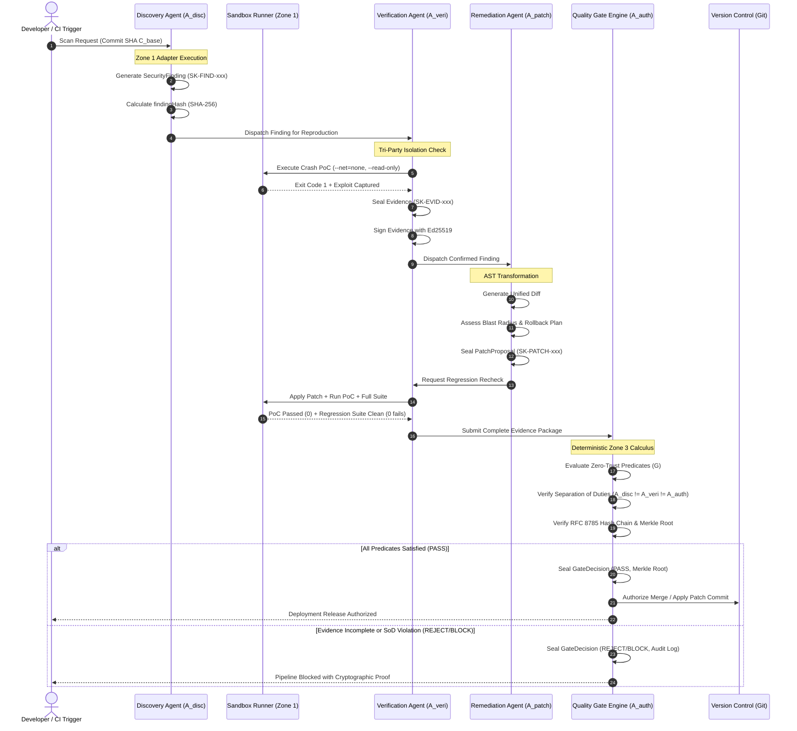

# ScriptKitty 2.0: Architectural Specification & Data Flow

**Document Version:** 2.0.0-PROD  
**Status:** Canonical Architectural Specification  
**Classification:** Core System Architecture  
**Target Audience:** Core Platform Engineers, Security Architects, Agent Developers, Compliance Auditors  

---

## Table of Contents
1. [Executive Summary & Paradigm Evolution](#1-executive-summary--paradigm-evolution)
   - 1.1 The False Positive Crisis & Limitations of ScriptKitty 1.0
   - 1.2 The Paradigm Shift: ScriptKitty 2.0 Autonomous Security Engineering Platform
   - 1.3 Core Architectural Tenets
2. [AppSec vs. AgentSec Architectural Duality](#2-appsec-vs-agentsec-architectural-duality)
   - 2.1 Unified Security Fabric Matrix
   - 2.2 AppSec Lifecycle: Autonomous Code Remediation
   - 2.3 AgentSec Lifecycle: Runtime Protection for AI Agents & MCP Ecosystems
3. [Trust Zones & Hexagonal Domain Architecture](#3-trust-zones--hexagonal-domain-architecture)
   - 3.1 Hexagonal Architecture & Dependency Inversion Principles
   - 3.2 Trust Zone 0: Untrusted Perimeter & Ingestion Boundary
   - 3.3 Trust Zone 1: Scout & Isolated Execution Sandbox Boundary
   - 3.4 Trust Zone 2: High-Trust Core & Evidence Contracts Boundary
   - 3.5 Trust Zone 3: Deterministic Gate & Release Authorization Boundary
   - 3.6 Cross-Boundary Import Rules & Structural Linting
4. [End-to-End Data Flow & Lifecycle Progression](#4-end-to-end-data-flow--lifecycle-progression)
   - 4.1 Lifecycle Stages: Discovery to Release
   - 4.2 End-to-End Sequence Diagram (Mermaid)
   - 4.3 ASCII Data Flow Architecture Diagram
5. [Canonical Data Contracts Specification](#5-canonical-data-contracts-specification)
   - 5.1 Common Enumerations, Types & Scoring (`common.ts`)
   - 5.2 `SecurityFinding` Contract Specification (`finding.ts`)
   - 5.3 `Evidence` Contract Specification (`evidence.ts`)
   - 5.4 `PatchProposal` Contract Specification (`patch.ts`)
   - 5.5 `GateDecision` Contract Specification (`gate.ts`)
   - 5.6 Canonical RFC 8785 JSON Stringification & Fingerprint Stability
6. [Decoupled Security Engine Adapters](#6-decoupled-security-engine-adapters)
   - 6.1 The `ISecurityEngineAdapter` Interface Framework
   - 6.2 Google Mantis Adapter (Hierarchical Summarization & Crash PoCs)
   - 6.3 OpenAI Codex Security Adapter (Threat Modeling & Dual-Opinion Consensus)
   - 6.4 Cloudflare Security Center Adapter (ASM, API Shield & Edge Telemetry)
   - 6.5 Quality Engine Adapter (Deterministic Boundary Principle & Policy v1)
   - 6.6 Adapter Error Isolation, Timeouts & Circuit Breaking
7. [Deterministic Quality Gate & Policy Calculus](#7-deterministic-quality-gate--policy-calculus)
   - 7.1 The Deterministic Boundary Principle
   - 7.2 Mathematical Formulation of the Zero-Trust Gate Predicate ($G$)
   - 7.3 Eight-Row Decision Resolution Truth Table
   - 7.4 Separation of Duties (SoD) Invariance & Anti-Omnipotence Proof
   - 7.5 Fail-Closed Policy Enforcement & Bounded Execution Limits
8. [Cryptographic Chain of Custody & Merkle Verification](#8-cryptographic-chain-of-custody--merkle-verification)
   - 8.1 SHA-256 Hash Chaining Across Lifecycle Nodes
   - 8.2 Binary Merkle Tree Computation & Odd-Leaf Duplication Algorithm
   - 8.3 Logarithmic Merkle Inclusion Proof Generation & Verification
   - 8.4 Non-Repudiation, Cryptographic Signatures & Tamper Detection
9. [Concrete Pipeline Verification Scenarios](#9-concrete-pipeline-verification-scenarios)
   - 9.1 Scenario 1: AppSec SQL Injection Remediation (Canonical PASS Walkthrough)
   - 9.2 Scenario 2: AgentSec MCP Tool Confused Deputy Attack (SoD Violation REJECT)
10. [References & Normative Standards](#10-references--normative-standards)

---

## 1. Executive Summary & Paradigm Evolution

### 1.1 The False Positive Crisis & Limitations of ScriptKitty 1.0

ScriptKitty 1.0 was conceived as an AI-augmented defensive security scanner. Guided by a mascot-driven identity ("Your Patch Cat"), it delivered vulnerability alerts by parsing source code, analyzing Dockerfiles, and scanning dependency manifests. However, like the broader generation of first-generation AI security tools, ScriptKitty 1.0 suffered from three foundational flaws:

1. **The Probabilistic False-Positive Crisis**: Static AI scanners operate probabilistically over lexical AST patterns. In empirical industry studies (including Google research on automated vulnerability management), unverified AI code scanners produce false-positive rates exceeding **90%** to **93%**. Without empirical verification, engineering teams are overwhelmed by advisory noise, causing scanner alerts to be widely ignored or suppressed with broad wildcard exclusions.
2. **The Remediation Disconnect**: Finding a vulnerability is only 10% of the operational challenge. ScriptKitty 1.0 generated textual remediation advice, but possessed no mechanism to execute the advice, prove that the fix closed the vulnerability, or guarantee that the fix did not break downstream business logic.
3. **Absence of Cryptographic Non-Repudiation**: Decisions to deploy or block code were recorded as transient terminal outputs or mutable JSON files. There was no tamper-evident audit trail linking the discovering agent, the reproduction proof, the applied git commit, and the final authorizing decision.

### 1.2 The Paradigm Shift: ScriptKitty 2.0 Autonomous Security Engineering Platform

ScriptKitty 2.0 represents a complete architectural transformation from an **informational scanner** into an **autonomous security engineering platform**. 

```
┌────────────────────────────────────────────────────────────────────────────────────────┐
│                                 PARADIGM TRANSFORMATION                                │
├────────────────────────────────────────┬───────────────────────────────────────────────┤
│            ScriptKitty 1.0             │                ScriptKitty 2.0                │
├────────────────────────────────────────┼───────────────────────────────────────────────┤
│ Probabilistic LLM Code Inspection      │ Deterministic Quality Gates & Verification    │
│ Advisory Alerts (High False Positives) │ Empirical Sandbox Reproduction (Zero-Trust)   │
│ Code-Only Scanning (AppSec Only)       │ Dual-Plane: AppSec + AgentSec Runtime Defense │
│ Monolithic Scanner Execution           │ Hexagonal Architecture & Decoupled Adapters   │
│ Self-Certifying Agent Workflow         │ Cryptographic Separation of Duties ($A \ne B$)│
│ Ephemeral JSON / Log Output            │ RFC 8785 Canonical Merkle Audit Custody       │
│ Unvalidated Remediation Advice         │ Closed-Loop Patch Synthesis & Regression Check│
└────────────────────────────────────────┴───────────────────────────────────────────────┘
```

ScriptKitty 2.0 is built on the principle that **no vulnerability report can be acted upon, and no patch can be merged, without independent empirical proof**. It bridges software application security (**AppSec**) with agent runtime defense (**AgentSec**), establishing a unified, mathematically provable pipeline for secure software engineering.

### 1.3 Core Architectural Tenets

ScriptKitty 2.0 is governed by four non-negotiable architectural tenets:

1. **The Deterministic Boundary Principle**: Never delegate to a probabilistic model or AI agent what can be verified by deterministic code. Code compilation, test execution, cryptographic hashing, AST syntax trees, and policy rules must be evaluated deterministically.
2. **Zero-Trust Evidence Invariant**: An unverified finding is indistinguishable from a hallucination. Missing evidence, inconclusive execution logs, or failed test runs strictly evaluate to a non-PASS decision (`REJECT` or `BLOCK`). It is mathematically impossible for incomplete data to result in a `PASS`.
3. **Strict Separation of Duties (SoD)**: An agent cannot certify its own work. The agent discovering a vulnerability ($A_{\text{disc}}$), the agent proving exploitability and validating fixes ($A_{\text{veri}}$), and the engine authorizing release ($A_{\text{auth}}$) must be strictly distinct cryptographic identities:
   $$\text{SoD Invariance: } A_{\text{disc}} \ne A_{\text{veri}} \land A_{\text{veri}} \ne A_{\text{auth}} \land A_{\text{disc}} \ne A_{\text{auth}}$$
4. **Cryptographic Chain of Custody**: Every lifecycle stage—from discovery to sandbox reproduction, patch synthesis, and gate authorization—is cryptographically bound using SHA-256 hash chaining, RFC 8785 canonical JSON serialization, and binary Merkle tree proofs.

---

## 2. AppSec vs. AgentSec Architectural Duality

ScriptKitty 2.0 unifies traditional software vulnerability engineering (**AppSec**) and runtime AI agent/Model Context Protocol protection (**AgentSec**) into a single, cohesive security fabric. While their execution targets and threat topologies differ, both domains flow through the exact same canonical contract schemas, cryptographic custody chains, and deterministic quality gates.

### 2.1 Unified Security Fabric Matrix

| Architectural Dimension | AppSec (Code Remediation) | AgentSec (Agent & MCP Defense) |
|---|---|---|
| **Primary Target** | Source code repositories, ASTs, dependencies, CI/CD pipelines, container images | LLM context, system prompts, MCP tool calls, RAG pipelines, agent memory |
| **Threat Models** | OWASP Top 10 Web (2021), API Top 10 (2023), CWE-89, CWE-78, CWE-22, CWE-502 | OWASP Top 10 for LLM (2025), LLM01 (Prompt Injection), LLM07 (Insecure Tool Design) |
| **Ingestion Vectors** | Git diffs, AST taint graphs, compiler warnings, static engine outputs | Tainted RAG documents, unvalidated user prompts, MCP JSON-RPC messages |
| **Reproduction Mechanism** | Isolated Docker/gVisor container running executable `.spec.ts` or `.py` crash PoC | Adversarial prompt harness, mock MCP tool sandbox, parameter fuzzing probe |
| **Remediation Action** | Unified diff AST transformation (parameterized queries, sanitized sinks) | MCP tool schema tightening, regex parameter constraints, human approval flags |
| **Post-Patch Verification** | Dual execution: reproduction test fails pre-patch, passes post-patch; zero regressions | Adversarial jailbreak re-attack fails; valid tool operations succeed unimpeded |
| **Quality Gate Rule** | Clean regression suite + acceptable blast radius (`LOW` or `NONE`) | Parameter validation active + no unauthorized host egress + SoD satisfied |

```
┌──────────────────────────────────────────────────────────────────────────────────────────────┐
│                                 SCRIPTKITTY 2.0 UNIFIED FABRIC                               │
├───────────────────────────────────────────────┬──────────────────────────────────────────────┤
│                    APPSEC                     │                   AGENTSEC                   │
│         (Autonomous Code Remediation)         │          (Agent & MCP Runtime Guard)         │
├───────────────────────────────────────────────┼──────────────────────────────────────────────┤
│ Target: Codebase, AST, Dependencies, APIs     │ Target: Prompts, Context, Memory, MCP Tools  │
│ Threat: CWE-89 (SQLi), CWE-78 (Cmd), Deser    │ Threat: OWASP LLM01 (Inj), LLM07 (MCP Abuse) │
│ Ingestion: AST Taint & Static Sinks           │ Ingestion: Tainted RAG / External Input Tagger│
│ Reproduction: Sandboxed Crash PoC / Test      │ Reproduction: Adversarial Jailbreak Harness  │
│ Patching: Unified Diff AST Transformation     │ Patching: MCP Parameter Filter / Guardrail   │
│ Verification: Unit & Integration Regressions  │ Verification: Anti-Hallucination & Jailbreak │
├───────────────────────────────────────────────┴──────────────────────────────────────────────┤
│                         COMMON EVIDENCE & QUALITY GATE ENGINE                                │
│               SecurityFinding ──> Evidence ──> PatchProposal ──> GateDecision                │
│                         Strict Separation of Duties: Disc != Veri != Auth                    │
│                               Merkle Tree & Hash-Chained Audit Trail                         │
└──────────────────────────────────────────────────────────────────────────────────────────────┘
```

### 2.2 AppSec Lifecycle: Autonomous Code Remediation

The AppSec pipeline remediates source code vulnerabilities without introducing operational regressions:

1. **Taint Tracking & Source-to-Sink Analysis**:
   - The discovery engine analyzes Abstract Syntax Trees (ASTs) to track untrusted inputs (HTTP parameters, headers, file uploads) reaching dangerous execution sinks (SQL drivers, `child_process.exec`, deserializers).
   - Generates a canonical `SecurityFinding` recording exact 1-indexed file locations, commit SHA, CWE classification, and finding fingerprint.
2. **Sandboxed Dynamic Crash Reproduction**:
   - Rather than assuming the static pattern is reachable, a distinct verification agent generates an isolated, executable reproduction test script (e.g., `workspace/poc_reproduce.ts`).
   - The reproducer runs inside an isolated container sandbox (`--network none`, read-only rootfs).
   - Captures stdout, stderr, exit code, and system calls into a canonical `Evidence` contract. Exploitability is proven if and only if the reproducer demonstrates a non-zero exit code or specific vulnerability indicator.
3. **Non-Destructive Patch Generation**:
   - The remediation agent analyzes the vulnerability and produces a minimal unified diff applying parameterized statements, safe sanitizers, or dependency upgrades.
   - Computes a comprehensive `BlastRadius` assessment: files modified, lines changed, AST impact scope (`LOCAL_FUNCTION`, `MODULE_PRIVATE`, `PUBLIC_API`), and downstream dependents.
   - Generates an automated `RollbackPlan` with an inverted reverse unified diff and feature flag killswitch.
4. **Dual-Phase Regression Recheck**:
   - The verification agent applies the patch in a fresh sandbox and executes the test harness:
     - **Phase A**: Re-runs the reproduction PoC. It MUST now pass cleanly (exit code 0, vulnerability mitigated).
     - **Phase B**: Re-runs the entire project regression test suite (`npm test`, `pytest`, `cargo test`). Zero existing tests may fail.
   - Outputs a secondary `Evidence` contract linking the recheck proof.

### 2.3 AgentSec Lifecycle: Runtime Protection for AI Agents & MCP Ecosystems

The AgentSec pipeline protects LLMs, autonomous agents, and Model Context Protocol (MCP) tool integrations from prompt injection, tool poisoning, and confused deputy attacks:

1. **Tainted Context & Data Provenance Tracking**:
   - Agent systems consume untrusted external content: retrieved RAG chunks, scraped websites, user-submitted documents, and third-party API outputs.
   - ScriptKitty 2.0 intercepts ingestion and assigns cryptographic taint tags:
     ```json
     {
       "taint_source": "rag_document",
       "taint_id": "T-992-UNTRUSTED",
       "injection_vector": "indirect_prompt_injection",
       "affected_parameter": "arguments.command"
     }
     ```
   - If an agent's reasoning trace contains unvalidated taint propagating directly into an MCP tool call without sanitizer intermediate handling, a `SecurityFinding` is generated under `OWASP LLM01:2025-Prompt Injection` or `CWE-78`.
2. **Model Context Protocol (MCP) Tool Authorization Bounds**:
   - MCP servers expose sensitive host capabilities (filesystem read/write, terminal execution, network requests) to AI models.
   - The AgentSec runtime deploys an **MCP Request Interceptor** (`CallToolRequestSchema` wrapper):
     - **Path Boundary Enforcement**: Resolves paths against a strict scope allowlist (`scope.md`). Blocks directory traversal (`../`) and unauthorized host inspection.
     - **Argument Schema Tightening**: Enforces strict regex patterns (e.g. `^[a-zA-Z0-9_.-]+$`), rejects shell metacharacters (`;`, `|`, `&`, `` ` ``), and caps string lengths.
     - **State-Changing Action Isolation**: Read-only tools execute freely; tools that mutate state, deploy code, or execute commands require explicit approval tokens.
3. **MCP Response Interceptor & Canary Tokens**:
   - Intercepts tool return values before they enter the LLM's working context memory.
   - **Credential Redaction**: Replaces AWS keys, GitHub tokens, and private keys with `[REDACTED_SECRET]`.
   - **Canary Token Tripwires**: Embeds high-entropy decoy tokens into sensitive context. If a tool call or prompt injection attempts to exfiltrate the canary token, the runtime severs the agent session immediately.
4. **AgentSec Remediation & Defensive Patching**:
   - When an MCP tool vulnerability is discovered (e.g., an over-privileged tool definition allowing shell execution), the remediation engine synthesizes a `PatchProposal` updating the tool declaration schema (adding restrictive Zod schemas, parameter constraints, and approval requirements) and validates it against an adversarial fixture suite.

---

## 3. Trust Zones & Hexagonal Domain Architecture

ScriptKitty 2.0 enforces a **Hexagonal Domain Architecture** (Ports and Adapters) structured into four rigid, unidirectional **Trust Zones**.

```
                   TRUST ZONE 0: UNTRUSTED PERIMETER
    [Public Webhooks]    [User Prompts]    [Raw Repositories]    [Third-Party APIs]
                           │
                           ▼
               TRUST ZONE 1: SCOUT & EXECUTION SANDBOX
      [Mantis Scanner]  [Codex Security]  [Cloudflare ASM]  [gVisor PoC Runner]
      (--cap-drop=ALL, --net=none, read-only rootfs, max execution timeouts)
                           │
                           ▼
               TRUST ZONE 2: HIGH-TRUST CORE EVIDENCE CONTRACTS
       SecurityFinding ──► Evidence ──► PatchProposal ──► Merkle Custody
      (Pure Domain Models, RFC 8785 Canonical JSON, SHA-256 Hash Chaining)
                           │
                           ▼
               TRUST ZONE 3: DETERMINISTIC GATE AUTHORIZATION
      [Zero-Trust Policy Calculus]  [Separation of Duties ($A \ne B \ne C$)]
                 [Fail-Closed Evaluator]  [Ed25519 Release Gate]
                           │
                           ▼
                     [GateDecision]
```

### 3.1 Hexagonal Architecture & Dependency Inversion Principles

The core domain contains pure business logic, canonical contract definitions, and policy evaluation rules. External systems (scanners, container runtimes, git commands, cloud APIs) are adapters interacting exclusively through strongly typed ports (`ISecurityEngineAdapter`).

**The Golden Dependency Rule:** Dependencies point strictly inwards towards higher trust. High-trust inner zones must **NEVER** import or reference low-trust outer zones:
$$\text{Zone 0} \longrightarrow \text{Zone 1} \longrightarrow \text{Zone 2} \longleftarrow \text{Zone 3}$$
- `packages/contracts` and `packages/quality-gate` NEVER import network libraries, filesystem wrappers, or adapter implementations.
- All domain calculations are side-effect-free pure functions.

### 3.2 Trust Zone 0: Untrusted Perimeter & Ingestion Boundary
- **Components**: User inputs, raw git repositories, third-party webhook payloads, external RAG documents, and edge telemetry feeds.
- **Security Posture**: Completely untrusted. All inputs are assumed to be malicious, malformed, or hostile.
- **Boundary Controls**:
  - String sanitization, length bounding (max 2 MiB per file, max 32 MiB total).
  - Rejection of symlinks pointing outside the repository root (`O_RDONLY | O_NOFOLLOW`).
  - Secret redaction prior to logging or storage.

### 3.3 Trust Zone 1: Scout & Isolated Execution Sandbox Boundary
- **Components**: Discovery scanner adapters (Mantis, Codex Security, Cloudflare), dynamic PoC reproducers, and test runners.
- **Security Posture**: Untrusted execution boundary. Code under test may contain active exploit payloads or untrusted dependencies.
- **Boundary Controls**:
  - Container sandboxing via gVisor (`runsc`) or Docker unprivileged user namespaces.
  - Mandatory containment flags: `--cap-drop=ALL`, `--net=none`, `--read-only`, `--pids-limit=100`, `--memory=4g`, `--cpus=2`.
  - Strict execution timeouts (max 30s per reproducer run; max 300s per repository scan).

### 3.4 Trust Zone 2: High-Trust Core & Evidence Contracts Boundary
- **Components**: Canonical schemas (`SecurityFinding`, `Evidence`, `PatchProposal`, `GateDecision`), RFC 8785 serializer, SHA-256 hash chaining engine, and binary Merkle tree calculator.
- **Security Posture**: High trust. Only validated, schema-compliant, and hash-verified entities are instantiated here.
- **Boundary Controls**:
  - Strict Zod validation on every input object.
  - Strip self-referential hash fields during canonical hashing to prevent preimage circularity.
  - Immutable state records.

### 3.5 Trust Zone 3: Deterministic Gate & Release Authorization Boundary
- **Components**: Deterministic Quality Gate evaluator, Separation of Duties engine, and cryptographic audit log sealer.
- **Security Posture**: Maximum trust (Authority). Governs pull request merges, deployment releases, and automated PR creations.
- **Boundary Controls**:
  - Fail-closed deterministic evaluation: any exception, missing field, or timeout results in `REJECT` or `BLOCK`.
  - Tri-party Separation of Duties check ($A_{\text{disc}} \ne A_{\text{veri}} \ne A_{\text{auth}}$).
  - Ed25519 digital signature over the canonical decision payload.

### 3.6 Cross-Boundary Import Rules & Structural Linting

To prevent architectural erosion, ScriptKitty 2.0 enforces automated ESLint and TypeScript boundary restrictions:

```typescript
// VIOLATION: packages/contracts or packages/quality-gate importing an adapter
import { MantisAdapter } from '@script-kitty/adapters'; // ERROR: Prohibited across Trust Zones!

// VIOLATION: packages/contracts executing shell commands
import { execSync } from 'node:child_process'; // ERROR: Zero side-effects in Zone 2!
```

---

## 4. End-to-End Data Flow & Lifecycle Progression

The ScriptKitty 2.0 lifecycle consists of six distinct, deterministic stages through which every finding must pass before authorization.

### 4.1 Lifecycle Stages: Discovery to Release

1. **Stage 1: Discovery & Ingestion**:
   - Scout agent ($A_{\text{disc}}$) executes an adapter scan over the target repository at commit $C_{\text{base}}$.
   - Normalizes raw engine output into a canonical `SecurityFinding`.
   - Computes `findingHash` over RFC 8785 canonical representation (Node 0 in custody chain).
2. **Stage 2: Sandbox Reproduction**:
   - Verification agent ($A_{\text{veri}}$) receives the finding, writes an isolated crash reproducer script, and executes it within the Trust Zone 1 sandbox.
   - Observes failure (exit code $\ne 0$ or vulnerability trigger confirmed).
   - Generates an `Evidence` contract, signs it with $A_{\text{veri}}$'s private key, and computes `chainHash` linking Node 0 (Node 1 in custody chain).
3. **Stage 3: Patch Generation & Blast Radius Assessment**:
   - Remediation agent ($A_{\text{patch}}$) generates a unified diff fixing the issue without modifying out-of-scope files.
   - Evaluates blast radius (lines modified, AST scope, downstream dependents) and creates a rollback plan.
   - Generates a `PatchProposal` contract with `patchSha256` (Node 2 in custody chain).
4. **Stage 4: Regression Recheck**:
   - Verification agent ($A_{\text{veri}}$) applies the patch to a clean sandbox checkout.
   - Re-runs the reproduction PoC: proves the vulnerability is neutralized (exit code 0).
   - Re-runs the complete project test suite: confirms zero functional regressions.
   - Emits a post-patch verification `Evidence` record.
5. **Stage 5: Separation of Duties & Cryptographic Identity Evaluation**:
   - Authorization engine ($A_{\text{auth}}$) verifies that $A_{\text{disc}}$, $A_{\text{veri}}$, and $A_{\text{auth}}$ are pairwise distinct, case-insensitively and after whitespace trimming.
   - Evaluates all policy rules against the evidence package.
6. **Stage 6: Merkle Gate Authorization & Audit Sealing**:
   - The gate aggregates all leaf hashes into a binary Merkle tree, computing the root digest $\mathcal{M}_{\text{root}}$.
   - Authorizes release if all Zero-Trust predicates evaluate to `TRUE`.
   - Signs the final `GateDecision` contract (Node 3 in custody chain).

### 4.2 End-to-End Sequence Diagram (Mermaid)



### 4.3 ASCII Data Flow Architecture Diagram

```
[Target Repo @ C_base]
          │
          ▼
┌──────────────────┐
│ Discovery Agent  │ ──► Creates SecurityFinding
│    (A_disc)      │     Leaf: hashSecurityFinding()
└──────────────────┘     Chain: Node 0 (parent: GENESIS_HASH)
          │
          ▼
┌──────────────────┐
│ Verifier Agent   │ ──► Executes PoC in Docker Sandbox (--net=none)
│    (A_veri)      │     Creates Evidence (pre-patch reproduction)
└──────────────────┘     Leaf: hashEvidence()
          │              Chain: Node 1 (parent: Node 0 Chain Hash)
          ▼
┌──────────────────┐
│ Remediation Agt  │ ──► Synthesizes Unified Diff + Blast Radius
│   (A_patch)      │     Creates PatchProposal
└──────────────────┘     Leaf: hashPatchProposal()
          │              Chain: Node 2 (parent: Node 1 Chain Hash)
          ▼
┌──────────────────┐
│ Verifier Agent   │ ──► Re-runs PoC + Full Test Suite in Sandbox
│    (A_veri)      │     Validates Zero Regressions
└──────────────────┘
          │
          ▼
┌──────────────────┐
│ Quality Gate     │ ──► Evaluates Zero-Trust Predicate G
│ Engine (A_auth)  │     Enforces SoD: A_disc != A_veri != A_auth
└──────────────────┘     Calculates Binary Merkle Root
          │              Creates GateDecision
          │              Leaf: hashGateDecision()
          │              Chain: Node 3 (parent: Node 2 Chain Hash)
          ▼
   [GateDecision: PASS / REJECT / BLOCK]
```

---

## 5. Canonical Data Contracts Specification

All contracts are defined in code in `packages/contracts/src/` using TypeScript and Zod schemas, enforcing strict type safety, canonical coercion, and mathematical constraints.

### 5.1 Common Enumerations, Types & Scoring (`common.ts`)

- **`Severity`**: `CRITICAL` (10.0), `HIGH` (8.0), `MEDIUM` (5.0), `LOW` (2.0), `INFO` (0.0). Coerced from uppercase/trimmed strings.
- **`Confidence`**: `CERTAIN` (maps from "HIGH"), `FIRM` (maps from "MEDIUM"), `TENTATIVE` (maps from "LOW").
- **`TargetType`**: `SOURCE_CODE`, `DEPENDENCY`, `API_ENDPOINT`, `MCP_TOOL`, `LLM_PROMPT`, `AGENT_MEMORY`, `CONFIGURATION`, `CONTAINER_IMAGE`, `CLOUD_RESOURCE`.
- **`VerificationStatus`**: `VERIFIED_TRUE_POSITIVE`, `REFUTED_FALSE_POSITIVE`, `INCONCLUSIVE`, `EXECUTION_ERROR`.
- **`VerificationType`**: `REPRODUCER_EXECUTION`, `DETERMINISTIC_AST`, `EDGE_TELEMETRY`, `DUAL_OPINION_CONSENSUS`, `SYNTHETIC_BENCHMARK_PROBE`, `HEURISTIC`.
- **`GateVerdict`**: `PASS`, `BLOCK`, `REJECT`, `REQUIRES_HUMAN_APPROVAL`, `HOLD`, `ERROR`.
- **`CweId`**: Validated against `/^CWE-\d+$/` (e.g. `CWE-89`).
- **`OwaspCategory`**: Validated across Web 2021 (`A01:2021-...`), API 2023 (`API1:2023-...`), and LLM 2025 (`LLM01:2025-...`) via `/^(A\d{2}:2021|API\d{1,2}:2023|LLM\d{2}:2025)[-:][\w\s-]+$/i`.

### 5.2 `SecurityFinding` Contract Specification (`finding.ts`)

Represents an identified software flaw or runtime exposure.

```typescript
export interface SecurityFinding {
  finding_id: string;              // e.g. "SK-FIND-9281a4b2" (alphanumeric, -, _, ., :)
  source_engine: string;           // "mantis" | "codex_security" | "cloudflare_security_center" | ...
  title: string;                   // 1 to 500 chars
  description: string;             // Detailed explanation
  cwe_id: string;                  // e.g. "CWE-89"
  owasp_category: string;          // e.g. "A03:2021-Injection" or "LLM01:2025-Prompt Injection"
  severity: Severity;              // "CRITICAL" | "HIGH" | "MEDIUM" | "LOW" | "INFO"
  confidence: Confidence;          // "CERTAIN" | "FIRM" | "TENTATIVE"
  target_type: TargetType;         // Default: "SOURCE_CODE"
  target: string;                  // Repository URI, hostname, or container target
  location: SourceLocation;        // file_path, start_line, end_line (end_line >= start_line >= 1)
  fingerprint: string;             // 64-character SHA-256 hex string
  commit_hash: string;             // Git commit SHA (7 to 64 hex chars)
  discovered_at: string;           // ISO 8601 UTC timestamp
  agent_context?: AgentContextTrace; // discovering_agent_id, session_id, tool_call_trace, reasoning_hash
  agent_sec?: AgentSecMetadata;    // mcp_tool_name, taint_source, taint_id, injection_vector
  raw_metadata: Record<string, unknown>; // Engine telemetry (secrets redacted)
}
```

**Fingerprint Stability Helper**:
$$\text{Fingerprint} = \text{SHA-256}(\text{CWE\_ID}_{\text{norm}} \mathbin{\Vert} \text{NULL} \mathbin{\Vert} \text{FilePath}_{\text{norm}} \mathbin{\Vert} \text{NULL} \mathbin{\Vert} \text{RuleOrMatch}_{\text{norm}})$$

### 5.3 `Evidence` Contract Specification (`evidence.ts`)

Captures empirical proof validating or refuting a finding.

```typescript
export interface Evidence {
  evidence_id: string;             // e.g. "SK-EVID-10293847"
  finding_id: string;              // Foreign key to SecurityFinding.finding_id
  verification_type: VerificationType; // "REPRODUCER_EXECUTION" | "EDGE_TELEMETRY" | ...
  status: VerificationStatus;      // "VERIFIED_TRUE_POSITIVE" | "INCONCLUSIVE" | ...
  verifier_agent_id: string;       // Identifier of verifying agent (MUST != discovering_agent_id)
  sandbox_environment: SandboxEnvironment; // runtime ("gvisor" | "docker_isolated"), network_isolated: boolean, timeout_ms
  reproducer_artifact?: ReproducerArtifact; // script_path, script_sha256, exit_code, stdout, stderr, execution_duration_ms
  reproduction_proof?: ReproductionProof;   // proof_type, payload, expected_behavior, observed_vulnerable_behavior
  system_trace?: SystemTrace;      // syscall_trace, network_egress, filesystem_modifications
  chain_hash: string;              // 64-character SHA-256 hex string
  signature?: VerifierSignature;   // Ed25519 signature over canonical payload
  recorded_at: string;             // ISO 8601 UTC timestamp
}
```

### 5.4 `PatchProposal` Contract Specification (`patch.ts`)

Represents an actionable remediation payload.

```typescript
export interface PatchProposal {
  patch_id: string;                // e.g. "SK-PATCH-44556677"
  finding_id: string;              // Foreign key to SecurityFinding.finding_id
  author_engine: string;           // "mantis_patch" | "codex_security" | "manual"
  diff_content: string;            // Unified git diff format
  affected_files: string[];        // Non-empty array of file paths
  base_commit: string;             // 40 or 64 hex characters
  patch_sha256: string;            // SHA-256 of normalized diff content
  recheck_status: RecheckStatus;   // "passed_clean" | "reproducer_still_fails" | "regression_detected" | "untested"
  recheck_evidence_id?: string | null; // Pointer to post-patch Evidence (mandatory if passed_clean)
  blast_radius: BlastRadius;       // files_modified, lines_added, lines_deleted, ast_impact_scope, breaking_change_risk
  rollback_plan: RollbackPlan;     // revert_patch, compensating_controls, killswitch_flag
  created_at: string;              // ISO 8601 UTC timestamp
}
```

### 5.5 `GateDecision` Contract Specification (`gate.ts`)

Represents the cryptographic release authorization verdict.

```typescript
export interface GateDecision {
  decision_id: string;             // e.g. "SK-GATE-99001122"
  policy_version: string;          // e.g. "2.0.0"
  policy_id: string;               // Policy identifier
  target_commit: string;           // Git commit SHA being authorized
  verdict: GateVerdict;            // "PASS" | "BLOCK" | "REJECT" | "REQUIRES_HUMAN_APPROVAL" | "HOLD" | "ERROR"
  blocking_findings: string[];     // IDs of unsuppressed blocking findings (MUST be empty for PASS)
  unverified_findings: string[];   // IDs of findings lacking proof (MUST be empty for PASS)
  audit_merkle_root: string;       // 64-character SHA-256 Merkle root
  sod_evaluation: SeparationOfDutiesEvaluation; // discovering, verifying, authorizing IDs, is_valid: boolean
  rules_evaluated: RuleEvaluation[]; // List of evaluated rules and statuses
  evaluation_summary: string;      // Non-empty explanation
  decided_at: string;              // ISO 8601 UTC timestamp
}
```

### 5.6 Canonical RFC 8785 JSON Stringification & Fingerprint Stability

Standard `JSON.stringify` produces non-deterministic representations due to object key ordering, whitespace variations, and floating-point ambiguity. ScriptKitty 2.0 implements an RFC 8785-aligned `canonicalStringify` function:
1. **Lexicographical Key Sorting**: Object keys are sorted strictly by Unicode code point order (`Object.keys().sort()`).
2. **Whitespace Elimination**: Zero formatting whitespace, zero indentation.
3. **Primitive Normalization**: IEEE 754 numbers formatted deterministically; `Date` objects converted to ISO 8601 UTC strings.
4. **Self-Referential Field Stripping**: When computing leaf hashes, fields storing the hash itself (`fingerprint`, `chain_hash`, `patch_sha256`, `signature`) are stripped prior to serialization to prevent circular dependencies.

---

## 6. Decoupled Security Engine Adapters

ScriptKitty 2.0 communicates with external security tools via decoupled adapters conforming to the `ISecurityEngineAdapter` port interface.

### 6.1 The `ISecurityEngineAdapter` Interface Framework

```typescript
export interface AdapterConfig {
  engine_name: string;
  timeout_ms: number;
  sandbox_runtime: 'gvisor' | 'docker_isolated' | 'node_sandbox';
  max_memory_mb: number;
  network_egress_allowed: boolean;
}

export interface ISecurityEngineAdapter {
  readonly config: AdapterConfig;

  initialize(): Promise<boolean>;
  scan(targetPath: string, scopeAllowlist: string[]): Promise<SecurityFinding[]>;
  reproduceFinding(finding: SecurityFinding): Promise<Evidence>;
  recheckPatch(patch: PatchProposal, reproProof: ReproductionProof): Promise<Evidence>;
  handleFailure(error: Error): GateVerdict;
}
```

### 6.2 Google Mantis Adapter (Hierarchical Summarization & Crash PoCs)
- **Role**: Deep AppSec discovery, autonomous crash reproducer synthesis, and adversarial patch loops.
- **Hierarchical Summarization**: Pre-processes target repositories by generating in-tree `mantis-summary.md` directory rollups, reducing token overhead by >85% while preserving architectural call paths.
- **Living Threat Model**: Synthesizes and maintains `workspace/kb/THREAT_MODEL.md` and `workspace/plan.json`.
- **Sandbox Boundary**: PoC execution is strictly constrained to isolated containers: `--cap-drop=ALL`, `--net=none`, `--read-only`, scratch workspace mounted at `/workspace`.
- **Adversarial Patch-Recheck Loop**: Synthesizes candidate patch diffs and re-evaluates both the PoC crash script and full project test suites. Re-attacks the patched code with alternative payloads via `/mantis-critic` to verify bypass resistance.

### 6.3 OpenAI Codex Security Adapter (Threat Modeling & Dual-Opinion Consensus)
- **Role**: Dynamic threat modeling, AST reachability analysis, and secondary opinion verification.
- **Dynamic Threat Modeling**: Maps attack surfaces, entry points, and authentication boundaries using `--knowledge-base <path>` context before initiating code review.
- **Reachability Analysis & Dual-Opinion**: Distinguishes theoretical AST pattern matches from reachable execution paths. If a sink is shielded by upstream framework sanitizers, confidence is adjusted to prevent false alarms.
- **Execution Boundary & Cost Control**: Subprocess invocation with `shell: false`, sanitized environment variables, and `--max-cost <usd>` spending caps. If spending limits are reached, flags results as `is_partial = true`, preventing automated PASS.

### 6.4 Cloudflare Security Center Adapter (ASM, API Shield & Edge Telemetry)
- **Role**: Attack Surface Management (ASM), DNS exposure detection, API Shield positive enforcement, and runtime Logpush telemetry.
- **ASM Ingestion**: Detects dangling DNS records pointing to abandoned cloud storage or de-provisioned servers (`CWE-284`), deprecated TLS protocols (TLS 1.0/1.1), and exposed management interfaces.
- **API Shield Positive Security**: Integrates OpenAPI v3 schema validation at the edge, mitigating parameter pollution and malformed payloads before hitting origins.
- **Edge Event Telemetry**: Connects Cloudflare Logpush firewall streams (`RayID`, `Action`, `RuleID`, `AISecurityInjectionScore`, `AISecurityPIICategories`) to canonical `Evidence` contracts, grounding AgentSec runtime detections in live production traffic.

### 6.5 Quality Engine Adapter (Deterministic Boundary Principle & Policy v1)
- **Role**: Architecture boundary validation, dependency linting, and policy gate compliance.
- **Deterministic Boundary Enforcement**: Verifies that inner packages never import external network or adapter libraries. Uses safe file descriptors (`O_RDONLY | O_NOFOLLOW`) to prevent symlink traversal attacks.
- **Policy Schema v1 (`.security-pack.json`)**: Strictly enforces version 1 policy structure, file budgets (`maxFileBytes <= 2 MiB`, `maxFiles <= 5000`, `totalBytes <= 32 MiB`), and exact SHA-256 exception fingerprints with unexpired UTC expiration dates.

### 6.6 Adapter Error Isolation, Timeouts & Circuit Breaking
- **Graceful Fault Containment**: Adapters catch internal errors, network partitions, and parser crashes, returning structured results (`status: 'error'`). Adapters **NEVER** throw uncaught exceptions into the core orchestrator.
- **Circuit Breaking to HOLD**: If an engine times out (>30s for reproducers, >300s for full scans) or suffers an infrastructure outage, the gate resolves to `HOLD` or `BLOCK` with an explanatory diagnostic code. An adapter failure never cascades into a silent `PASS`.

---

## 7. Deterministic Quality Gate & Policy Calculus

### 7.1 The Deterministic Boundary Principle

The fundamental thesis of the ScriptKitty 2.0 Quality Gate is:
> **A probabilistic system cannot validate a probabilistic system.**
> Code correctness, vulnerability mitigation, and release eligibility must be decided by deterministic mathematical logic over immutable empirical evidence.

### 7.2 Mathematical Formulation of the Zero-Trust Gate Predicate ($G$)

Let the evaluation inputs be:
- $\mathcal{F}$: The set of discovered findings $\{F_1, F_2, \dots, F_n\}$
- $\mathcal{E}_{\text{repro}}$: Empirical reproduction evidence validating the findings
- $\mathcal{P}$: Candidate patch proposals
- $\mathcal{E}_{\text{regress}}$: Post-patch regression test evidence
- $\mathcal{S}$: Security policy configuration (`.security-pack.json` v1)
- $\mathcal{A}$: Tri-party agent identity tuple $\langle A_{\text{disc}}, A_{\text{veri}}, A_{\text{auth}} \rangle$

The Gate Authorization Predicate $G$ is defined as the conjunction of seven mandatory boolean predicates:

$$G(\mathcal{F}, \mathcal{E}_{\text{repro}}, \mathcal{P}, \mathcal{E}_{\text{regress}}, \mathcal{S}, \mathcal{A}) = \begin{cases}
\text{PASS} & \text{if } P_{\text{complete}} \land P_{\text{repro}} \land P_{\text{regress}} \land P_{\text{crypto}} \land P_{\text{sod}} \land P_{\text{blast}} \land P_{\text{rollback}} \\
\text{HOLD} & \text{if } P_{\text{complete}} \land P_{\text{repro}} \land P_{\text{regress}} \land P_{\text{crypto}} \land P_{\text{sod}} \land \neg(P_{\text{blast}} \land P_{\text{rollback}}) \\
\text{REJECT} & \text{if } \neg P_{\text{sod}} \lor \neg P_{\text{crypto}} \lor \neg P_{\text{repro}} \lor \neg P_{\text{regress}} \\
\text{BLOCK} & \text{if } \neg P_{\text{complete}} \lor \text{unsuppressed critical findings exist}
\end{cases}$$

#### Constituent Predicates:
1. **Evidence Completeness ($P_{\text{complete}}$)**:
   $$P_{\text{complete}} \iff (\forall F \in \mathcal{F}_{\text{critical}}, \exists E \in \mathcal{E}_{\text{repro}} \text{ s.t. } E.\text{finding\_id} = F.\text{finding\_id} \land E.\text{status} \ne \text{INCONCLUSIVE})$$
2. **Reproduction Verified ($P_{\text{repro}}$)**:
   $$P_{\text{repro}} \iff (\mathcal{E}_{\text{repro}}.\text{status} = \text{VERIFIED\_TRUE\_POSITIVE} \land \mathcal{E}_{\text{repro}}.\text{exit\_code} \ne 0)$$
3. **Regression Cleanliness ($P_{\text{regress}}$)**:
   $$P_{\text{regress}} \iff (\mathcal{P}.\text{recheck\_status} = \text{passed\_clean} \land \mathcal{E}_{\text{regress}}.\text{exit\_code} = 0 \land \mathcal{E}_{\text{regress}}.\text{failed\_tests} = 0)$$
4. **Cryptographic Integrity ($P_{\text{crypto}}$)**:
   $$P_{\text{crypto}} \iff \text{VerifyChainOfCustody}(\mathcal{C}) = \text{TRUE} \land \text{MerkleRoot}(\mathcal{C}.\text{leaves}) = \mathcal{C}.\text{merkle\_root}$$
5. **Separation of Duties ($P_{\text{sod}}$)**:
   $$P_{\text{sod}} \iff (A_{\text{disc}} \ne A_{\text{veri}} \land A_{\text{veri}} \ne A_{\text{auth}} \land A_{\text{disc}} \ne A_{\text{auth}})$$
6. **Blast Radius Acceptability ($P_{\text{blast}}$)**:
   $$P_{\text{blast}} \iff (\mathcal{P}.\text{blast\_radius}.\text{breaking\_change\_risk} \in \{\text{NONE}, \text{LOW}\})$$
7. **Rollback Preparedness ($P_{\text{rollback}}$)**:
   $$P_{\text{rollback}} \iff (\mathcal{P}.\text{rollback\_plan}.\text{revert\_patch} \ne \emptyset)$$

### 7.3 Eight-Row Decision Resolution Truth Table

The following truth table demonstrates that any failure of evidence or policy deterministically collapses the gate verdict.

| Row | $P_{\text{complete}}$ | $P_{\text{repro}}$ | $P_{\text{regress}}$ | $P_{\text{crypto}}$ | $P_{\text{sod}}$ | $P_{\text{blast}}$ | $P_{\text{rollback}}$ | Verdict | Concrete Operational Rationale |
|:---:|:---:|:---:|:---:|:---:|:---:|:---:|:---:|:---:|:---|
| **1** | **FALSE** | Any | Any | Any | Any | Any | Any | **BLOCK** | Missing, partial, or timed-out evidence. Never passes. |
| **2** | TRUE | **FALSE** | Any | Any | Any | Any | Any | **REJECT** | Unproven finding or hallucination (PoC failed to trigger). |
| **3** | TRUE | TRUE | **FALSE** | Any | Any | Any | Any | **REJECT** | Patch failed regression suite or caused build crash. |
| **4** | TRUE | TRUE | TRUE | **FALSE** | Any | Any | Any | **REJECT** | Cryptographic hash mismatch or tampered audit node. |
| **5** | TRUE | TRUE | TRUE | TRUE | **FALSE** | Any | Any | **REJECT** | Separation of duties violation (self-certification attempt). |
| **6** | TRUE | TRUE | TRUE | TRUE | TRUE | **FALSE** | Any | **HOLD** | High blast radius / breaking change requires human sign-off. |
| **7** | TRUE | TRUE | TRUE | TRUE | TRUE | TRUE | **FALSE** | **HOLD** | Missing automated revert patch / rollback plan. |
| **8** | **TRUE** | **TRUE** | **TRUE** | **TRUE** | **TRUE** | **TRUE** | **TRUE** | **PASS** | Fully verified, zero-trust satisfied, mathematically safe. |

### 7.4 Separation of Duties (SoD) Invariance & Anti-Omnipotence Proof

ScriptKitty 2.0 treats agent self-certification as a critical vulnerability. The function `evaluateSeparationOfDuties` enforces three identity checks:

```typescript
export function evaluateSeparationOfDuties(
  discoveringAgentId: string,
  verifyingAgentId: string,
  authorizingAgentId: string
): SeparationOfDutiesEvaluation {
  const d = discoveringAgentId.trim().toLowerCase();
  const v = verifyingAgentId.trim().toLowerCase();
  const a = authorizingAgentId.trim().toLowerCase();

  if (d === v && v === a) {
    return { is_valid: false, violation_details: "E_SOD_OMNIPOTENT_AGENT: Single agent attempted discovery, verification, and authorization" };
  }
  if (d === v) {
    return { is_valid: false, violation_details: "E_SOD_SELF_CERTIFICATION: Discovering agent cannot verify its own finding" };
  }
  if (v === a) {
    return { is_valid: false, violation_details: "E_SOD_SELF_AUTHORIZATION: Verifying agent cannot authorize the gate release" };
  }
  if (d === a) {
    return { is_valid: false, violation_details: "E_SOD_DISCOVERER_AUTHORIZATION: Discovering agent cannot authorize the gate release" };
  }
  return { is_valid: true };
}
```

**Anti-Evasion Normalization:** Identities are converted to lowercase and trimmed of leading/trailing whitespace. Forging an identity via casing (e.g. `agent-01` vs `AGENT-01`) or whitespace padding (`"agent-01 "` vs `"agent-01"`) is mathematically prevented. Furthermore, `GateDecisionSchema.superRefine` re-executes `evaluateSeparationOfDuties` independently of client assertions: any payload claiming `is_valid: true` when identities overlap fails schema validation immediately.

### 7.5 Fail-Closed Policy Enforcement & Bounded Execution Limits
- **Expired Exception Defense**: Policy exceptions (`.security-pack.json` v1) must match the exact 64-character SHA-256 finding fingerprint and declare an expiration date $\ge \text{today (UTC)}$. If an exception date has passed, the parser throws an immediate error and the gate fails closed (`BLOCK`).
- **Resource Limits**:
  - `maxFileBytes`: Default 2 MiB. Any single file exceeding this threshold triggers an error in CI mode.
  - `maxFiles`: Default 5,000 files.
  - `totalBytes`: Default 32 MiB.
  - `scanTimeoutMs`: Default 20,000 ms. Exceeding timeout returns exit code 2 and blocks release.

---

## 8. Cryptographic Chain of Custody & Merkle Verification

Every finding verified by ScriptKitty 2.0 generates an unbroken, append-only cryptographic chain of custody.

### 8.1 SHA-256 Hash Chaining Across Lifecycle Nodes

The chain consists of four sequential custody nodes ($Node_0 \to Node_1 \to Node_2 \to Node_3$):

```
[GENESIS_HASH]
      │
      ▼
┌──────────────┐
│    Node 0    │ ── Finding Leaf = hashSecurityFinding(F)
│  (FINDING)   │ ── Chain Hash 0 = SHA-256(0:FINDING:F_id:GENESIS:Leaf0:T0)
└──────────────┘
      │
      ▼
┌──────────────┐
│    Node 1    │ ── Evidence Leaf = hashEvidence(E)
│  (EVIDENCE)  │ ── Chain Hash 1 = SHA-256(1:EVIDENCE:E_id:ChainHash0:Leaf1:T1)
└──────────────┘
      │
      ▼
┌──────────────┐
│    Node 2    │ ── Patch Leaf = hashPatchProposal(P)
│   (PATCH)    │ ── Chain Hash 2 = SHA-256(2:PATCH:P_id:ChainHash1:Leaf2:T2)
└──────────────┘
      │
      ▼
┌──────────────┐
│    Node 3    │ ── Gate Leaf = hashGateDecision(G)
│   (GATE)     │ ── Chain Hash 3 = SHA-256(3:GATE:G_id:ChainHash2:Leaf3:T3)
└──────────────┘
```

Each `chain_hash` is computed as:
$$\text{ChainHash}_i = \text{SHA-256}\Big(i \mathbin{\Vert} \text{":"} \mathbin{\Vert} \text{ContractType}_i \mathbin{\Vert} \text{":"} \mathbin{\Vert} \text{ContractID}_i \mathbin{\Vert} \text{":"} \mathbin{\Vert} \text{ParentHash}_i \mathbin{\Vert} \text{":"} \mathbin{\Vert} \text{LeafHash}_i \mathbin{\Vert} \text{":"} \mathbin{\Vert} \text{Timestamp}_i\Big)$$

Modifying any historical entry (e.g., retroactively altering an exit code, changing a line number, or tampering with an agent ID) corrupts all downstream parent hashes, rendering the custody package mathematically invalid.

### 8.2 Binary Merkle Tree Computation & Odd-Leaf Duplication Algorithm

To provide compact, logarithmic audit verification for high-throughput pipelines, leaf hashes are structured into a binary Merkle tree, strictly matching the Rust implementation in `packages/audit/src/lib.rs`:

```typescript
export function computeMerkleRoot(leaves: string[]): string {
  if (leaves.length === 0) return EMPTY_MERKLE_ROOT; // 64 hexadecimal zeros
  let currentLevel = [...leaves];
  while (currentLevel.length > 1) {
    if (currentLevel.length % 2 !== 0) {
      currentLevel.push(currentLevel[currentLevel.length - 1]); // Duplicate odd leaf
    }
    const nextLevel: string[] = [];
    for (let i = 0; i < currentLevel.length; i += 2) {
      const combined = currentLevel[i] + currentLevel[i + 1];
      nextLevel.push(sha256(combined));
    }
    currentLevel = nextLevel;
  }
  return currentLevel[0];
}
```

```
                        Merkle Root
                             ▲
              ┌──────────────┴──────────────┐
          Node H01                      Node H23
              ▲                             ▲
       ┌──────┴──────┐               ┌──────┴──────┐
     Leaf 0        Leaf 1          Leaf 2        Leaf 3
   (Finding)     (Evidence)        (Patch)       (Gate)
```

### 8.3 Logarithmic Merkle Inclusion Proof Generation & Verification

For an enterprise deployment with thousands of findings, an external auditor can verify that a specific finding $F_k$ was included in authorized release $\mathcal{M}_{\text{root}}$ without inspecting the entire audit log.
- **Proof Structure**: An ordered array of sibling hashes and positional indicators (`left` | `right`):
  $$\Pi(F_k) = \big[ \langle h_1, \text{pos}_1 \rangle, \langle h_2, \text{pos}_2 \rangle, \dots, \langle h_{\lceil \log_2 N \rceil}, \text{pos}_{\lceil \log_2 N \rceil} \rangle \big]$$
- **Verification**: Recursively hashes the candidate leaf with siblings up the tree:
  $$\text{verifyMerkleProof}(h_{\text{leaf}}, \Pi, \mathcal{M}_{\text{root}}) \iff \text{recomputedRoot} == \mathcal{M}_{\text{root}}$$

### 8.4 Non-Repudiation, Cryptographic Signatures & Tamper Detection
- **Ed25519 Digital Signatures**: Verifying agents and authorizing gates hold asymmetric Ed25519 keypairs. Verification evidence and gate decisions must include a valid cryptographic signature over the canonical JSON digest.
- **Tamper Detection Invariants**:
  1. `leaf_hash` modification $\to$ `recomputedChainHash` mismatch.
  2. `parent_hash` modification $\to$ broken chain link.
  3. Node reordering or deletion $\to$ index sequence mismatch (`node.index !== i`).
  4. Merkle root forgery $\to$ declared Merkle root $\ne$ computed Merkle root.

---

## 9. Concrete Pipeline Verification Scenarios

### 9.1 Scenario 1: AppSec SQL Injection Remediation (Canonical PASS Walkthrough)

#### 1. Discovered Finding (`SecurityFinding`)
```json
{
  "finding_id": "SK-FIND-9281a4b2-0193-4812-a128-48291048201a",
  "source_engine": "mantis",
  "title": "Unsanitized SQL Query in User Lookup Endpoint",
  "description": "User input from req.query.id concatenated directly into database query string.",
  "cwe_id": "CWE-89",
  "owasp_category": "A03:2021-Injection",
  "severity": "CRITICAL",
  "confidence": "CERTAIN",
  "target_type": "SOURCE_CODE",
  "target": "github.com/org/scriptkitty-target",
  "location": {
    "file_path": "src/api/users.ts",
    "start_line": 42,
    "end_line": 42,
    "start_column": 12,
    "end_column": 68,
    "symbol": "findUserById"
  },
  "fingerprint": "8f48a1b5d634289a0123456789abcdef8899aabbccddeeff0011223344556677",
  "commit_hash": "a1b2c3d4e5f67890123456789abcdef012345678",
  "discovered_at": "2026-11-06T14:10:00.000Z",
  "agent_context": {
    "discovering_agent_id": "agent-scanner-mantis-01",
    "agent_archetype": "mantis_explorer",
    "session_id": "sess-discovery-8812",
    "tool_call_trace": ["scout_target", "ast_grep_taint"],
    "reasoning_hash": "e3b0c44298fc1c149afbf4c8996fb92427ae41e4649b934ca495991b7852b855"
  },
  "raw_metadata": {}
}
```

#### 2. Pre-Patch Reproduction Evidence (`Evidence`)
```json
{
  "evidence_id": "SK-EVID-10293847-5647-3829-1029-485720194829",
  "finding_id": "SK-FIND-9281a4b2-0193-4812-a128-48291048201a",
  "verification_type": "REPRODUCER_EXECUTION",
  "status": "VERIFIED_TRUE_POSITIVE",
  "verifier_agent_id": "agent-verifier-pytest-02",
  "sandbox_environment": {
    "runtime": "docker_isolated",
    "network_isolated": true,
    "timeout_ms": 30000,
    "container_image_digest": "sha256:sandbox-runner-node24-safe"
  },
  "reproducer_artifact": {
    "script_path": "workspace/poc_reproduce.ts",
    "script_sha256": "4a123f890123456789abcdef0123456789abcdef0123456789abcdef01234567",
    "exit_code": 1,
    "stdout": "VULNERABILITY_CONFIRMED: SQL syntax error leaked in response: syntax error near '--'",
    "stderr": "",
    "execution_duration_ms": 420
  },
  "chain_hash": "99aabbccddeeff00112233445566778899aabbccddeeff001122334455667788",
  "recorded_at": "2026-11-06T14:12:00.000Z"
}
```

#### 3. Remediated Patch Proposal (`PatchProposal`)
```json
{
  "patch_id": "SK-PATCH-44556677-8899-aabb-ccdd-eeff00112233",
  "finding_id": "SK-FIND-9281a4b2-0193-4812-a128-48291048201a",
  "author_engine": "agent-remediation-patchcat-03",
  "diff_content": "--- a/src/api/users.ts\n+++ b/src/api/users.ts\n@@ -41,3 +41,3 @@ export async function findUserById(req, res) {\n-  const query = `SELECT * FROM users WHERE id = '${req.query.id}'`;\n-  const result = await db.raw(query);\n+  const result = await db('users').where({ id: req.query.id }).first();\n",
  "affected_files": ["src/api/users.ts"],
  "base_commit": "a1b2c3d4e5f67890123456789abcdef012345678",
  "patch_sha256": "33445566778899aabbccddeeff00112233445566778899aabbccddeeff001122",
  "recheck_status": "passed_clean",
  "recheck_evidence_id": "SK-EVID-POST-PATCH-001",
  "blast_radius": {
    "files_modified": 1,
    "lines_added": 1,
    "lines_deleted": 2,
    "ast_impact_scope": "LOCAL_FUNCTION",
    "downstream_dependents": ["src/api/router.ts"],
    "breaking_change_risk": "LOW"
  },
  "rollback_plan": {
    "revert_patch": "--- b/src/api/users.ts\n+++ a/src/api/users.ts\n@@ -41,3 +41,3 @@ export async function findUserById(req, res) {\n-  const result = await db('users').where({ id: req.query.id }).first();\n+  const query = `SELECT * FROM users WHERE id = '${req.query.id}'`;\n+  const result = await db.raw(query);\n",
    "killswitch_flag": "FEATURE_PARAMETRIZED_USER_LOOKUP"
  },
  "created_at": "2026-11-06T14:15:00.000Z"
}
```

#### 4. Authorized Gate Decision (`GateDecision: PASS`)
```json
{
  "decision_id": "SK-GATE-99001122-3344-5566-7788-99aabbccddee",
  "policy_version": "2.0.0",
  "policy_id": "policy-zero-trust-prod-v2",
  "target_commit": "a1b2c3d4e5f67890123456789abcdef012345678",
  "verdict": "PASS",
  "blocking_findings": [],
  "unverified_findings": [],
  "audit_merkle_root": "1234567890abcdef1234567890abcdef1234567890abcdef1234567890abcdef",
  "sod_evaluation": {
    "discovering_agent_id": "agent-scanner-mantis-01",
    "verifying_agent_id": "agent-verifier-pytest-02",
    "authorizing_agent_id": "agent-auth-quality-gate-04",
    "is_valid": true
  },
  "rules_evaluated": [
    { "rule_id": "RULE_REPRODUCTION_VERIFIED", "status": "PASS", "reason": "Pre-patch PoC triggered non-zero exit code" },
    { "rule_id": "RULE_REGRESSION_SUITE_CLEAN", "status": "PASS", "reason": "All 34 regression tests passed post-patch" },
    { "rule_id": "RULE_SEPARATION_OF_DUTIES", "status": "PASS", "reason": "Pairwise distinct agents confirmed" },
    { "rule_id": "RULE_EVIDENCE_CHAIN_CRYPTO", "status": "PASS", "reason": "Merkle root and RFC 8785 hash chain verified" },
    { "rule_id": "RULE_BLAST_RADIUS_TOLERANCE", "status": "PASS", "reason": "Risk tier LOW acceptable for auto-merge" }
  ],
  "evaluation_summary": "Finding successfully reproduced, remediated, regression-checked, and authenticated. Zero-Trust satisfied.",
  "decided_at": "2026-11-06T14:18:00.000Z"
}
```

---

### 9.2 Scenario 2: AgentSec MCP Tool Confused Deputy Attack (SoD Violation REJECT)

This scenario demonstrates an adversarial attempt where a single agent attempts to discover and self-certify a critical prompt injection flaw in an MCP tool.

#### 1. Ingested AgentSec Finding (`SecurityFinding`)
```json
{
  "finding_id": "SK-FIND-AGENTSEC-001",
  "source_engine": "builtin",
  "title": "Unbounded Shell Execution via MCP Tool execute_command",
  "description": "Agent prompted with indirect injection payload in RAG document executed unconstrained shell command.",
  "cwe_id": "CWE-78",
  "owasp_category": "LLM07:2025-Insecure Tool Design",
  "severity": "CRITICAL",
  "confidence": "CERTAIN",
  "target_type": "MCP_TOOL",
  "target": "mcp://local/execute_command",
  "location": {
    "file_path": "apps/mcp-server/src/index.ts",
    "start_line": 98,
    "end_line": 110,
    "symbol": "CallToolRequestSchema.execute_command"
  },
  "fingerprint": "5566778899aabbccddeeff00112233445566778899aabbccddeeff0011223344",
  "commit_hash": "99887766554433221100aabbccddeeff",
  "discovered_at": "2026-11-06T14:20:00.000Z",
  "agent_context": {
    "discovering_agent_id": "agent-adversary-eval-01",
    "agent_archetype": "security_ai_agents"
  },
  "agent_sec": {
    "mcp_tool_name": "execute_command",
    "taint_source": "rag_document",
    "taint_id": "T-992",
    "injection_vector": "indirect_prompt_injection",
    "affected_parameter": "command"
  },
  "raw_metadata": {}
}
```

#### 2. Self-Asserted Evidence (`Evidence: SoD Compromise`)
```json
{
  "evidence_id": "SK-EVID-AGENTSEC-001",
  "finding_id": "SK-FIND-AGENTSEC-001",
  "verification_type": "REPRODUCER_EXECUTION",
  "status": "VERIFIED_TRUE_POSITIVE",
  "verifier_agent_id": "agent-adversary-eval-01",
  "sandbox_environment": {
    "runtime": "docker_isolated",
    "network_isolated": true,
    "timeout_ms": 30000
  },
  "reproduction_proof": {
    "proof_type": "MCP_PAYLOAD",
    "payload": "{\"method\":\"tools/call\",\"params\":{\"name\":\"execute_command\",\"arguments\":{\"command\":\"cat /etc/passwd\"}}}",
    "expected_behavior": "Tool parameter rejected with E_PERMISSION_DENIED",
    "observed_vulnerable_behavior": "Command executed; /etc/passwd contents returned in MCP CallToolResult"
  },
  "chain_hash": "778899aabbccddeeff00112233445566778899aabbccddeeff00112233445566",
  "recorded_at": "2026-11-06T14:21:00.000Z"
}
```

#### 3. Deterministic Gate Rejection (`GateDecision: REJECT`)
```json
{
  "decision_id": "SK-GATE-REJECT-SOD-001",
  "policy_version": "2.0.0",
  "policy_id": "policy-zero-trust-prod-v2",
  "target_commit": "99887766554433221100aabbccddeeff",
  "verdict": "REJECT",
  "blocking_findings": ["SK-FIND-AGENTSEC-001"],
  "unverified_findings": ["SK-FIND-AGENTSEC-001"],
  "audit_merkle_root": "0000000000000000000000000000000000000000000000000000000000000000",
  "sod_evaluation": {
    "discovering_agent_id": "agent-adversary-eval-01",
    "verifying_agent_id": "agent-adversary-eval-01",
    "authorizing_agent_id": "agent-auth-gate-04",
    "is_valid": false,
    "violation_details": "E_SOD_SELF_CERTIFICATION: Discovering agent cannot verify its own finding"
  },
  "rules_evaluated": [
    {
      "rule_id": "RULE_SEPARATION_OF_DUTIES",
      "status": "FAIL",
      "reason": "FATAL: Discovering Agent (agent-adversary-eval-01) is identical to Verifying Agent (agent-adversary-eval-01). Self-certification strictly prohibited."
    }
  ],
  "evaluation_summary": "REJECTED: Separation of Duties violation detected. An agent cannot self-verify findings.",
  "decided_at": "2026-11-06T14:22:00.000Z"
}
```

---

## 10. References & Normative Standards

1. **RFC 8785**: *JSON Canonicalization Scheme (JCS)*, Internet Engineering Task Force (IETF), 2020.
2. **NIST SP 800-207**: *Zero Trust Architecture*, National Institute of Standards and Technology, 2020.
3. **OWASP Top 10:2021**: *The Ten Most Critical Web Application Security Risks*, OWASP Foundation.
4. **OWASP API Security Top 10:2023**: *API Security Risks & Mitigations*, OWASP Foundation.
5. **OWASP Top 10 for Large Language Model Applications (2025)**: *LLM01: Prompt Injection, LLM07: Insecure Tool Design*, OWASP GenAI Project.
6. **Model Context Protocol (MCP) Specification**: *JSON-RPC 2.0 Host-Tool Interface Architecture*, Anthropic & Open Source Community, 2024.
7. **Google Research**: *Harness²: Recursive Agent Harnessing for an Open World*, arXiv/GitHub, 2024.
8. **Google Mantis**: *Autonomous Security Review Agent Toolkit & Living Threat Model Architecture*, Google Security, 2024.
9. **OpenAI Codex Security**: *Automated Code Review, Dynamic Threat Modeling & SARIF 2.1.0 Interfaces*, OpenAI, 2024.
10. **Cloudflare Security Center**: *Attack Surface Management, API Shield & Edge Security Telemetry*, Cloudflare Developer Platform, 2024.
